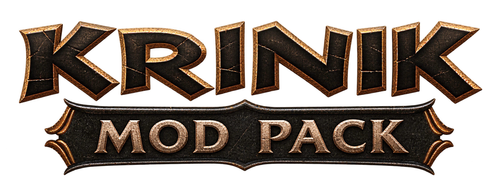

  

# Krinik's Conan Exiles Enhanced ModPack

<h3 align="center"><em>Сборка модов для Conan Exiles Enhanced 3.0.1 — версия 1.0.0.</em></h3>

  
  &nbsp;
  

  <a href="#1-общие-сведения">Общие сведения</a> · <a href="#2-состав-сборки">Состав</a> · <a href="#3-установка">Установка</a> · <a href="#4-удаление">Удаление</a> · <a href="#5-отзывы-и-обратная-связь">Отзывы</a> · <a href="#6-правообладатели-и-отказ-от-ответственности">Правообладатели</a> · <a href="#7-лицензия">Лицензия</a>

**Krinik Mod Pack — сборка модов для Conan Exiles Enhanced 3.0.1: 7 модов автора сборки, 64 мода других авторов из Мастерской Steam и Nexus Mods, загрузчик UE4SS, лаунчер и русский перевод всех модов.**

Сборка устанавливается, запускается и удаляется из одного окна лаунчера, а отчёт для автора сборки игрок собирает прямо из меню игры.

## 1. Общие сведения

### 1.1. Основные положения

1. Krinik Mod Pack 1.0.0 от 31.10.2026 — первый выпуск сборки. Сборка рассчитана на Conan Exiles Enhanced 3.0.1 (билд CL-379176), а прежде собиралась под версии игры 2.1.1 и 2.2.3.
2. Состав сборки и порядок загрузки модов задаёт манифест `modpack.json`. Раскатывает сборку по папке игры движок [KUMM](https://github.com/MikalaiKryvusha/kumm).
3. Все моды сборки переведены на русский язык в терминах русской версии игры.
4. Руководство пользователя — [docs/guide/Krinik-Conan-3.0.1-guide.pdf](docs/guide/Krinik-Conan-3.0.1-guide.pdf): возможности сборки, клавиши, состав, история версий.

### 1.2. Содержимое репозитория

| Путь | Содержимое |
|---|---|
| `modpack.json` | манифест сборки: моды в порядке загрузки, их источники и версии |
| `_unpacked/` | исходники модов автора сборки и загрузчик UE4SS |
| `_config/` | конфиги игры, лаунчер, деинсталлятор, файлы перевода, инструменты сборки |
| `docs/guide/` | руководство пользователя: PDF и его HTML-исходник |
| `docs/` | заметки по игре, модам и их совместимости |

Архивы модов других авторов в репозиторий не входят. Их источник — Мастерская Steam и Nexus Mods.

## 2. Состав сборки

В сборку входят 7 модов её автора, загрузчик UE4SS и 64 мода других авторов. Знаком **KRINIK MODIFIED** отмечены моды других авторов с доработками для сборки: перевод на русский язык, правка интерфейса, исправление ошибок.

Таблица 1 — Моды сборки

| № | Мод | Автор | Что делает |
|---|---|---|---|
| 1 | [KrinikConanCamera](_unpacked/KrinikConanCamera) | Кот Криник | Камера от третьего лица стоит строго за спиной героя. Положение камеры (расстояние, высота, боковое смещение, наклон взгляда) задаётся с цифрового блока клавиатуры, сохраняется и сбрасывается. |
| 2 | [KrinikConanArchery](_unpacked/KrinikConanArchery) | Кот Криник | Стрела уходит в точку прицела по дуге, а её скорость задаёт сила натяжения лука по физике The Elder Scrolls IV: Oblivion. Вид от первого лица с луком в руках, стрельба в прыжке. |
| 3 | [KrinikConanGameplay](_unpacked/KrinikConanGameplay) | Кот Криник | Прокачка героя до 10 000 уровня. За каждое очко Проворства герой быстрее бегает и выше прыгает. |
| 4 | [KrinikConanUI](_unpacked/KrinikConanUI) | Кот Криник | Пауза в инвентаре и хабе, HUD Hosav, переработанный для читаемости, счётчик кадров и кнопка «Отзыв» в главном меню и в меню Esc. |
| 5 | [KrinikConanGraphics](_unpacked/KrinikConanGraphics) | Кот Криник | Пятна крови лежат на земле до пяти минут и плавно гаснут. Настройки графики сборки: дальность прорисовки, тени, туман, DLSS. |
| 6 | [KrinikConanRussianTranslation](_config/localization) | Кот Криник | Русский перевод текстов всех модов сборки. |
| 7 | [KrinikConanModPackManager](_unpacked/KrinikConanModPackManager) | Кот Криник | Заставка на всё время загрузки игры и строка состояния сборки в главном меню: сколько модов сборки загрузила игра. |
| 8 | [UE4SS](https://github.com/UE4SS-RE/RE-UE4SS) | Narknon, UE4SS-RE | Загрузчик Lua-модов для Unreal Engine. На нём работают Lua-моды сборки. |
| 9 | [Hosav's Custom UI](https://steamcommunity.com/sharedfiles/filedetails/?id=3748867573) KRINIK MODIFIED | Hosav | Интерфейс игры заменён настраиваемым HUD, у которого больше 50 параметров. |
| 10 | [Simple Minimap](https://steamcommunity.com/sharedfiles/filedetails/?id=3719513784) KRINIK MODIFIED | Xevyr | Мини-карта с метками мест и пятью ступенями приближения. |
| 11 | [Simple Modlist](https://steamcommunity.com/sharedfiles/filedetails/?id=3719546290) KRINIK MODIFIED | Xevyr | Список включённых модов с версиями в меню Esc. |
| 12 | [The Damage Meter](https://steamcommunity.com/sharedfiles/filedetails/?id=3719585133) KRINIK MODIFIED | Xevyr | Счётчик урона и урона в секунду в реальном времени: герой, спутники, другие игроки. |
| 13 | [Proximity Party](https://steamcommunity.com/sharedfiles/filedetails/?id=3718878457) | Xevyr | Полоски здоровья ближних спутников и соклановцев, до 15 одновременно. |
| 14 | [Lore & Loot Highlight](https://steamcommunity.com/sharedfiles/filedetails/?id=3718655125) | Xevyr | Подсветка контуром всего, с чем можно взаимодействовать, и отдельный цвет для сундуков с добычей. |
| 15 | [ModControlPanel](https://steamcommunity.com/sharedfiles/filedetails/?id=3722388367) | hades | Единое окно настроек модов. |
| 16 | [Pickup+](https://steamcommunity.com/sharedfiles/filedetails/?id=864199675) | nO Pa!N | Возврат любой поставленной вещи в инвентарь. |
| 17 | [PackRat Helper](https://steamcommunity.com/sharedfiles/filedetails/?id=2596031352) | thelich | Раскладка рюкзака по сундукам и станциям, где уже лежат такие же вещи. |
| 18 | [Inventory Compactor](https://steamcommunity.com/sharedfiles/filedetails/?id=3718614759) | Xevyr | Кнопка уплотнения инвентаря: уборка пустых ячеек и объединение стопок. |
| 19 | [Organizer Sorting Chest](https://steamcommunity.com/sharedfiles/filedetails/?id=3723101055) | Mikey | Сундук-сортировщик: положенная в него добыча расходится по сундукам вокруг, где лежат такие же вещи. |
| 20 | [Chest Labels](https://steamcommunity.com/sharedfiles/filedetails/?id=3735258746) | Xevyr | Надписи с именем сундука или шкафа на самой мебели. |
| 21 | [Storage Reach Expanded](https://steamcommunity.com/sharedfiles/filedetails/?id=3733835102) | Seriihn | Строительство и крафт из сундуков всей базы. |
| 22 | [Double Storage Space](https://steamcommunity.com/sharedfiles/filedetails/?id=3803465771) | Dog Patch 06 | Удвоена вместимость хранилищ. |
| 23 | [Less Building Placement Restrictions](https://steamcommunity.com/sharedfiles/filedetails/?id=3755091710) | Multigun | Сняты запреты игры на постановку построек в свободном месте. |
| 24 | [Beyond Decor: Rustic Edition](https://steamcommunity.com/sharedfiles/filedetails/?id=3729154757) | Cateyes | Более 3 000 предметов деревенского убранства: спальня, кухня и столовая, гостиная, сад, рынок и лавки. |
| 25 | [Ancient Civilization](https://steamcommunity.com/sharedfiles/filedetails/?id=3721996090) | Asghaard | Постройки древней подгорной цивилизации с собственной цепочкой производства. |
| 26 | [Emberlight](https://steamcommunity.com/sharedfiles/filedetails/?id=3741684658) | Emberlight | Стойла и разведение животных, поля, пивоварение, святилища, таверны с артистами и купальни. |
| 27 | [Ironlight-Settlements](https://steamcommunity.com/sharedfiles/filedetails/?id=3741725671) KRINIK MODIFIED | Ca\$hfire | Поселение с распорядком дня рабов: сон, еда, работа, тренировки, торговля и патрули. |
| 28 | [Ironlight-Settlements-RPG](https://steamcommunity.com/sharedfiles/filedetails/?id=3780656133) | Ca\$hfire | Гигиена рабов и профессия артиста. |
| 29 | [Faster Elevator](https://steamcommunity.com/sharedfiles/filedetails/?id=3729885653) | Fritzli | Ускорены вертикальные и горизонтальные лифты. |
| 30 | [Highmane's Arsenal](https://steamcommunity.com/sharedfiles/filedetails/?id=3721926604) | Dracula | Более 2 000 предметов: сотни видов оружия с собственными связками ударов и более 500 украшений. |
| 31 | [Enhanced Armory and Arsenal](https://steamcommunity.com/sharedfiles/filedetails/?id=3718199031) KRINIK MODIFIED | Solvita | Более 700 видов оружия и более 350 видов брони, классы с собственным опытом, руны и система славы. |
| 32 | [Era of Trials](https://steamcommunity.com/sharedfiles/filedetails/?id=3744562094) KRINIK MODIFIED | Orero | Комплекты брони и оружие для каждой из семи религий, пять видов магического урона, волны верующих после убийства жреца. |
| 33 | [LegitReligious](https://steamcommunity.com/sharedfiles/filedetails/?id=3720748663) | wyrm-x | Эпическая броня и оружие у религиозных алтарей. |
| 34 | [MSCasaDesFlores — Weapons & Armors](https://steamcommunity.com/sharedfiles/filedetails/?id=3734522624) | La Sombra MesSiinaa | Мечи, топоры, копья, кинжалы, луки, стрелы, щиты и броня для героев с 55 по 120 уровень. |
| 35 | [More Katanas](https://steamcommunity.com/sharedfiles/filedetails/?id=3741906845) | Hazelberry | Новые ступени катан, одноручные катаны и вакидзаси для левой руки. |
| 36 | [Immersive Warriors Enhanced](https://steamcommunity.com/sharedfiles/filedetails/?id=3742373178) KRINIK MODIFIED | BAMB | Атаки и комбинации ударов для катаны, меча, двуручного оружия и рукопашного боя; анимации усталости, еды и питья. |
| 37 | [TDI_LegendaryRepair](https://steamcommunity.com/sharedfiles/filedetails/?id=3723127994) | TiktaalikDreaming | Ремонтные наборы для легендарных и уникальных вещей. |
| 38 | [Arrow Quick Swap](https://steamcommunity.com/sharedfiles/filedetails/?id=3724971404) KRINIK MODIFIED | Grey Fox | Смена вида стрел в прицеле и переход на следующий вид, когда стрелы кончаются. |
| 39 | [Corpse Stripper](https://www.nexusmods.com/conanexilesenhanced/mods/14) | xtrekiller | С убитых неигровых персонажей и боссов выпадает всё надетое снаряжение. |
| 40 | [My Absolutely Unnecessary Thrall Army](https://www.nexusmods.com/conanexilesenhanced/mods/22) | xtrekiller | Отряд героя расширен до 100 спутников. |
| 41 | [Bosses My New Besties](https://www.nexusmods.com/conanexilesenhanced/mods/18) | xtrekiller | Оглушение и взятие в рабы боссов, минибоссов и уникальных неигровых персонажей. |
| 42 | [EAA Lv50 Thralls](https://steamcommunity.com/sharedfiles/filedetails/?id=3725707777) | Solvita | Уровень рабов поднят до 50, перки на 10, 15, 20, 35 и 50 уровнях. |
| 43 | [Extended Thrall Stats](https://steamcommunity.com/sharedfiles/filedetails/?id=3720737911) | Grandpa Who | Панель раба и питомца: множители урона, здоровье за очко живучести, настоящее имя. |
| 44 | [Thrall Inventory x2](https://steamcommunity.com/sharedfiles/filedetails/?id=3733163336) | Wyrd-Oh | Удвоен инвентарь рабов. |
| 45 | [Riding Thralls](https://steamcommunity.com/sharedfiles/filedetails/?id=3803149679) | Sunhildr | Рабы едут верхом рядом с героем. |
| 46 | [Rideable Pets](https://steamcommunity.com/sharedfiles/filedetails/?id=3817969576) | WickedVixen | Почти пятьдесят ездовых зверей. |
| 47 | [Player Ignores Follower Collision](https://steamcommunity.com/sharedfiles/filedetails/?id=3720753923) KRINIK MODIFIED | Deadlayn | Герой проходит сквозь своих спутников в дверях, на лестницах и в бою. |
| 48 | [Thrall_Peeper](https://steamcommunity.com/sharedfiles/filedetails/?id=3723820003) | Tater | Имя раба при наведении на него прицела. |
| 49 | [Diverse Barkeeps](https://steamcommunity.com/sharedfiles/filedetails/?id=3722887659) | DeviouSaint | Трактирщики девяти народов в клетках тюремщика с равным шансом. |
| 50 | [Better Tavern PATRONS](https://steamcommunity.com/sharedfiles/filedetails/?id=3729932396) | Wyrd-Oh | Посетителем таверны героя может стать почти любой раб игры. |
| 51 | [Exiles Fishing](https://steamcommunity.com/sharedfiles/filedetails/?id=3718368769) KRINIK MODIFIED | Jaar F Love | Рыбалка: заброс, слежение за рыбой и вываживание; 60 видов рыбы в четырёх биомах. |
| 52 | [Automatic Fish Trap](https://steamcommunity.com/sharedfiles/filedetails/?id=3720452046) | Fritzli | Ловушки для рыбы и моллюсков, в том числе глубоководная. |
| 53 | [Caverns of Set](https://steamcommunity.com/sharedfiles/filedetails/?id=3722525736) | PNutt | Пещеры с поселением Akhlut Outpost между Логовом, Безымянным городом и Разбитыми источниками. |
| 54 | [Shemite City State](https://steamcommunity.com/sharedfiles/filedetails/?id=3755371705) | PNutt | Город-государство за стенами на западе саванны: подземелье и свои неигровые персонажи. |
| 55 | [Ymir's Respite](https://steamcommunity.com/sharedfiles/filedetails/?id=3730427175) | PNutt | Пещерное подземелье с ареной босса на севере. |
| 56 | [Al-Merayah Reborn](https://steamcommunity.com/sharedfiles/filedetails/?id=3718036277) | Xevyr | Возвращена вырезанная разработчиком Funcom разрушаемая крепость с неигровыми персонажами и осадой. |
| 57 | [Waystones Enhanced](https://steamcommunity.com/sharedfiles/filedetails/?id=3813660690) | Red | Путевые камни с переносом между ними по карте мира. |
| 58 | [Ragnar's New Factions](https://steamcommunity.com/sharedfiles/filedetails/?id=3717969878) KRINIK MODIFIED | Ragnar Random | Более 700 новых неигровых персонажей среди родных фракций, расселённых по миру. |
| 59 | [RNF NPC Distribution](https://steamcommunity.com/sharedfiles/filedetails/?id=3819183152) | Ragnar Random | Дополнение к Ragnar's New Factions: вместе с ним расселяет новых персонажей по миру. |
| 60 | [Night Terrors](https://steamcommunity.com/sharedfiles/filedetails/?id=3723538551) | DeviouSaint | Ночные встречи с демонами и нежитью вне базы с 10 уровня. |
| 61 | [PvE Plus Ambush](https://steamcommunity.com/sharedfiles/filedetails/?id=3721274811) | Multigun | Засады на героя с 9 уровня. |
| 62 | [Severe Weather Enhanced](https://steamcommunity.com/sharedfiles/filedetails/?id=3721071602) KRINIK MODIFIED | drachenfeles | Температура по климату, своя погода и бури, тёмные подземелья. |
| 63 | [Resource Stimulus Package](https://www.nexusmods.com/conanexilesenhanced/mods/34) | xtrekiller | Железо, кристалл и сера добываются из камней, кристалл и лёд из железных жил; с трупов добычи больше. |
| 64 | [Reliable Meteor Showers](https://steamcommunity.com/sharedfiles/filedetails/?id=3723073788) | Xevyr | Досрочный метеоритный дождь, когда на карте остаётся пять узлов звёздного металла или меньше. |
| 65 | [Edit Appearance](https://steamcommunity.com/sharedfiles/filedetails/?id=3751947496) | IdeaPoet | Редактор внешности героя в самой игре. |
| 66 | [Heritage](https://steamcommunity.com/sharedfiles/filedetails/?id=3726392245) | Dread Swoop | Расы мира по описаниям народов в книгах Роберта Говарда; постоянные лица для 162 именных персонажей. |
| 67 | [Female New Faces](https://steamcommunity.com/sharedfiles/filedetails/?id=3753757942) | mr.weaz | Новые женские лица, глаза, брови и причёски в создании героя. |
| 68 | [Ostavar: Salon](https://steamcommunity.com/sharedfiles/filedetails/?id=3734199233) | Dani | Около 60 женских и 50 мужских причёсок, часть из них с физикой волос. |
| 69 | [Hair We Go](https://steamcommunity.com/sharedfiles/filedetails/?id=3731128190) | dame.en.noir | Набор причёсок. |
| 70 | [True (Hair) Colors](https://steamcommunity.com/sharedfiles/filedetails/?id=3731099424) | Dread Swoop | Насыщенная палитра цветов волос и бород. |
| 71 | [MSCasaDesFlores — Nails Station](https://steamcommunity.com/sharedfiles/filedetails/?id=3723318347) | La Sombra MesSiinaa | 58 вариантов ногтей на руках и ногах, раскраски и причёски. |
| 72 | [No-Intro-Splash](https://www.nexusmods.com/conanexilesenhanced/mods/1) | Gametism | Отключены вступительные ролики при запуске игры. |

## 3. Установка

1. Убедитесь, что установлена игра Conan Exiles Enhanced 3.0.1 (билд CL-379176).
2. Распакуйте архив сборки в папку игры, где лежит файл `ConanSandbox.exe`.
3. Запустите `KrinikConanLauncher.exe` из папки сборки и нажмите «Установить сборку». Лаунчер находит игру по папке, в которой лежит сборка.
4. Нажмите «Играть».
5. Если разрешение экрана ниже 3840 × 2160, смените его в настройках игры.

Сборка задаёт полноэкранный режим 3840 × 2160 и русский язык игры. Запасной путь установки — файл `install.cmd` в папке сборки. В архиве сборки лежат обои для рабочего стола в разрешениях 4K, 2K и 1080p.

## 4. Удаление

1. Закройте игру.
2. Запустите `KrinikConanLauncher.exe` и нажмите «Удалить сборку».
3. Подтвердите удаление в появившемся окне.

Игра возвращается в состояние до установки сборки. Запасной путь удаления — файл `uninstall_krinik_build.cmd` в папке игры.

## 5. Отзывы и обратная связь

Автор сборки принимает отзывы, вопросы и сообщения о сбоях. К сообщению о вылете, зависании игры или неверной работе мода приложите отчёт.

1. Нажмите кнопку «Отзыв» в главном меню игры или в меню Esc. Если игра закрыта, запустите `KrinikConanLauncher.exe`, нажмите «Отзыв», затем «Собрать отчёт».
2. Дождитесь, пока на рабочем столе появится файл `Conan-report-<дата>_<время>.zip`.
3. Отправьте файл автору сборки и опишите в письме, что происходило в игре перед сбоем и повторяется ли сбой.

В отчёт входят журналы игры, сведения о вылетах без дампов памяти и журнал Lua-модов. Идентификаторы машины и аккаунта, имя компьютера и путь профиля в отчёт не попадают. С вопросом по сборке пишите автору без отчёта.

## 6. Ссылки

- Почта: [kotkrinik@yandex.ru](mailto:kotkrinik@yandex.ru)
- Личные сообщения на PlayGround: [users.playground.ru/4580431](https://users.playground.ru/4580431/)
- Публичный репозиторий сборки на GitHub: [github.com/MikalaiKryvusha/Kriniks_Conan_Exiles_Enhanced_ModPack](https://github.com/MikalaiKryvusha/Kriniks_Conan_Exiles_Enhanced_ModPack)

## 7. Правообладатели и отказ от ответственности

1. Моды других авторов принадлежат своим законным правообладателям — авторам модов в Мастерской Steam и на Nexus Mods. Авторы и страницы модов названы в таблице 1.
2. Мод с пометкой KRINIK MODIFIED остаётся собственностью автора мода. Доработки для сборки не передают автору сборки прав на мод.
3. Игра Conan Exiles и её версия Conan Exiles Enhanced принадлежат Funcom и законным правообладателям. Названия, товарные знаки и материалы игры принадлежат соответствующим владельцам.
4. Автор сборки, Николай Кривуша (Кот Криник), не претендует на материалы, права на которые ему не принадлежат. Его работа в сборке — подбор модов и порядок их загрузки, настройки, перевод, доработки модов с пометкой KRINIK MODIFIED, собственные моды Krinik и лаунчер.
5. Сборка предназначена для ознакомления и работает поверх установленной игры Conan Exiles Enhanced.
6. Сборка предоставляется «как есть» (as is), без каких-либо гарантий, явных или подразумеваемых. Автор сборки не несёт ответственности за любой ущерб, потерю сохранений или данных и иные последствия установки и использования сборки.

## 8. Лицензия

[MIT](LICENSE) — © 2026 **Mikalai Kryvusha** aka **KOT KRINIK** · Николай Кривуша aka Кот Криник.

Сборка выпущена под лицензией MIT и открыта для ознакомления всему человечеству. Лицензия MIT распространяется на работу автора сборки: моды Krinik, лаунчер, конфиги, скрипты и тексты этого репозитория. Файлы других правообладателей в репозитории остаются под своими лицензиями: загрузчик UE4SS — MIT © Narknon (`_unpacked/UE4SS/ue4ss/LICENSE`), шрифты — SIL Open Font License (`_config/branding/fonts/`).

Спасибо и приятной игры!

---

# Krinik's Conan Exiles Enhanced ModPack

<h3 align="center"><em>A mod pack for Conan Exiles Enhanced 3.0.1 — version 1.0.0.</em></h3>

  
  &nbsp;
  

  <a href="#1-general">General</a> · <a href="#2-contents-of-the-pack">Contents</a> · <a href="#3-installation">Installation</a> · <a href="#4-removal">Removal</a> · <a href="#5-feedback">Feedback</a> · <a href="#6-rights-holders-and-disclaimer">Rights holders</a> · <a href="#7-license">License</a>

**Krinik Mod Pack is a mod pack for Conan Exiles Enhanced 3.0.1: 7 mods by the pack author, 64 mods by other authors from the Steam Workshop and Nexus Mods, the UE4SS loader, a launcher and a Russian translation of every mod.**

The pack is installed, launched and removed from a single launcher window, and a player collects a report for the pack author straight from the game menu.

## 1. General

### 1.1. Basic provisions

1. Krinik Mod Pack 1.0.0 (2026-10-31) is the first release of the pack. It targets Conan Exiles Enhanced 3.0.1 (build CL-379176); earlier it targeted game versions 2.1.1 and 2.2.3.
2. The manifest `modpack.json` defines what the pack contains and the order in which the mods load. The [KUMM](https://github.com/MikalaiKryvusha/kumm) engine deploys the pack into the game folder.
3. Every mod in the pack is translated into Russian in the terms of the game's Russian version.
4. The user guide is [docs/guide/Krinik-Conan-3.0.1-guide.pdf](docs/guide/Krinik-Conan-3.0.1-guide.pdf) (in Russian): features, keys, contents, version history.

### 1.2. Contents of the repository

| Path | Contents |
|---|---|
| `modpack.json` | the pack manifest: the mods in load order, their sources and versions |
| `_unpacked/` | the sources of the pack author's mods and the UE4SS loader |
| `_config/` | game configs, the launcher, the uninstaller, translation files, pack-building tools |
| `docs/guide/` | the user guide: the PDF and its HTML source |
| `docs/` | notes on the game, the mods and their compatibility |

Archives of other authors' mods are not part of the repository; they come from the Steam Workshop and Nexus Mods.

## 2. Contents of the pack

The pack holds 7 mods by its author, the UE4SS loader and 64 mods by other authors. **KRINIK MODIFIED** marks mods by other authors that were changed for the pack: Russian translation, interface fixes, bug fixes.

Table 1 — Mods of the pack

| No. | Mod | Author | What it does |
|---|---|---|---|
| 1 | [KrinikConanCamera](_unpacked/KrinikConanCamera) | KOT KRINIK | The third-person camera stands strictly behind the hero. The camera position (distance, height, side offset, view pitch) is set from the numeric keypad, saved and reset. |
| 2 | [KrinikConanArchery](_unpacked/KrinikConanArchery) | KOT KRINIK | The arrow flies along an arc to the aim point, and the draw strength sets its speed after the physics of The Elder Scrolls IV: Oblivion. First-person view with the bow in hand, shooting in a jump. |
| 3 | [KrinikConanGameplay](_unpacked/KrinikConanGameplay) | KOT KRINIK | Hero levelling up to level 10,000. Every point of Agility makes the hero run faster and jump higher. |
| 4 | [KrinikConanUI](_unpacked/KrinikConanUI) | KOT KRINIK | Pause in the inventory and the hub, the Hosav HUD reworked for readability, a frame counter and the «Отзыв» (Feedback) button in the main menu and the Esc menu. |
| 5 | [KrinikConanGraphics](_unpacked/KrinikConanGraphics) | KOT KRINIK | Blood stains stay on the ground for up to five minutes and fade out smoothly. The graphics settings of the pack: draw distance, shadows, fog, DLSS. |
| 6 | [KrinikConanRussianTranslation](_config/localization) | KOT KRINIK | Russian translation of the texts of every mod in the pack. |
| 7 | [KrinikConanModPackManager](_unpacked/KrinikConanModPackManager) | KOT KRINIK | A splash screen for the whole game load and a pack status line in the main menu: how many mods of the pack the game has loaded. |
| 8 | [UE4SS](https://github.com/UE4SS-RE/RE-UE4SS) | Narknon, UE4SS-RE | Lua mod loader for Unreal Engine. The Lua mods of the pack run on it. |
| 9 | [Hosav's Custom UI](https://steamcommunity.com/sharedfiles/filedetails/?id=3748867573) KRINIK MODIFIED | Hosav | The game interface is replaced by a customisable HUD with more than 50 settings. |
| 10 | [Simple Minimap](https://steamcommunity.com/sharedfiles/filedetails/?id=3719513784) KRINIK MODIFIED | Xevyr | A minimap with place markers and five zoom steps. |
| 11 | [Simple Modlist](https://steamcommunity.com/sharedfiles/filedetails/?id=3719546290) KRINIK MODIFIED | Xevyr | The list of enabled mods with their versions in the Esc menu. |
| 12 | [The Damage Meter](https://steamcommunity.com/sharedfiles/filedetails/?id=3719585133) KRINIK MODIFIED | Xevyr | A real-time meter of damage and damage per second: the hero, the followers, other players. |
| 13 | [Proximity Party](https://steamcommunity.com/sharedfiles/filedetails/?id=3718878457) | Xevyr | Health bars of nearby followers and clanmates, up to 15 at a time. |
| 14 | [Lore & Loot Highlight](https://steamcommunity.com/sharedfiles/filedetails/?id=3718655125) | Xevyr | An outline on everything the hero can interact with, and a separate colour for loot chests. |
| 15 | [ModControlPanel](https://steamcommunity.com/sharedfiles/filedetails/?id=3722388367) | hades | One settings window for the mods. |
| 16 | [Pickup+](https://steamcommunity.com/sharedfiles/filedetails/?id=864199675) | nO Pa!N | Any placed item can be picked back up into the inventory. |
| 17 | [PackRat Helper](https://steamcommunity.com/sharedfiles/filedetails/?id=2596031352) | thelich | Sorts the backpack into the chests and stations that already hold the same items. |
| 18 | [Inventory Compactor](https://steamcommunity.com/sharedfiles/filedetails/?id=3718614759) | Xevyr | An inventory compaction button: empty slots are removed, stacks are merged. |
| 19 | [Organizer Sorting Chest](https://steamcommunity.com/sharedfiles/filedetails/?id=3723101055) | Mikey | A sorting chest: the loot put into it spreads over the chests around that hold the same items. |
| 20 | [Chest Labels](https://steamcommunity.com/sharedfiles/filedetails/?id=3735258746) | Xevyr | The name of a chest or cabinet written on the furniture itself. |
| 21 | [Storage Reach Expanded](https://steamcommunity.com/sharedfiles/filedetails/?id=3733835102) | Seriihn | Building and crafting from the chests of the whole base. |
| 22 | [Double Storage Space](https://steamcommunity.com/sharedfiles/filedetails/?id=3803465771) | Dog Patch 06 | Storage capacity is doubled. |
| 23 | [Less Building Placement Restrictions](https://steamcommunity.com/sharedfiles/filedetails/?id=3755091710) | Multigun | The game no longer forbids placing buildings in open space. |
| 24 | [Beyond Decor: Rustic Edition](https://steamcommunity.com/sharedfiles/filedetails/?id=3729154757) | Cateyes | Over 3,000 rustic decor items: bedroom, kitchen and dining room, living room, garden, market and shops. |
| 25 | [Ancient Civilization](https://steamcommunity.com/sharedfiles/filedetails/?id=3721996090) | Asghaard | Buildings of an ancient under-mountain civilisation with their own production chain. |
| 26 | [Emberlight](https://steamcommunity.com/sharedfiles/filedetails/?id=3741684658) | Emberlight | Stables and animal breeding, fields, brewing, shrines, taverns with entertainers and bathhouses. |
| 27 | [Ironlight-Settlements](https://steamcommunity.com/sharedfiles/filedetails/?id=3741725671) KRINIK MODIFIED | Ca\$hfire | A settlement with a daily routine for thralls: sleep, meals, work, training, trade and patrols. |
| 28 | [Ironlight-Settlements-RPG](https://steamcommunity.com/sharedfiles/filedetails/?id=3780656133) | Ca\$hfire | Thrall hygiene and the entertainer profession. |
| 29 | [Faster Elevator](https://steamcommunity.com/sharedfiles/filedetails/?id=3729885653) | Fritzli | Vertical and horizontal lifts run faster. |
| 30 | [Highmane's Arsenal](https://steamcommunity.com/sharedfiles/filedetails/?id=3721926604) | Dracula | Over 2,000 items: hundreds of weapons with their own combos and over 500 accessories. |
| 31 | [Enhanced Armory and Arsenal](https://steamcommunity.com/sharedfiles/filedetails/?id=3718199031) KRINIK MODIFIED | Solvita | Over 700 weapons and over 350 armour pieces, classes with their own experience, runes and a renown system. |
| 32 | [Era of Trials](https://steamcommunity.com/sharedfiles/filedetails/?id=3744562094) KRINIK MODIFIED | Orero | Armour sets and weapons for each of the seven religions, five kinds of magic damage, waves of believers after a priest is killed. |
| 33 | [LegitReligious](https://steamcommunity.com/sharedfiles/filedetails/?id=3720748663) | wyrm-x | Epic armour and weapons at the religious altars. |
| 34 | [MSCasaDesFlores — Weapons & Armors](https://steamcommunity.com/sharedfiles/filedetails/?id=3734522624) | La Sombra MesSiinaa | Swords, axes, spears, daggers, bows, arrows, shields and armour for heroes of levels 55 to 120. |
| 35 | [More Katanas](https://steamcommunity.com/sharedfiles/filedetails/?id=3741906845) | Hazelberry | New katana tiers, one-handed katanas and a wakizashi for the off hand. |
| 36 | [Immersive Warriors Enhanced](https://steamcommunity.com/sharedfiles/filedetails/?id=3742373178) KRINIK MODIFIED | BAMB | Attacks and combos for the katana, the sword, two-handed weapons and unarmed combat; animations of fatigue, eating and drinking. |
| 37 | [TDI_LegendaryRepair](https://steamcommunity.com/sharedfiles/filedetails/?id=3723127994) | TiktaalikDreaming | Repair kits for legendary and unique items. |
| 38 | [Arrow Quick Swap](https://steamcommunity.com/sharedfiles/filedetails/?id=3724971404) KRINIK MODIFIED | Grey Fox | Switching the arrow type while aiming, and moving on to the next type when the arrows run out. |
| 39 | [Corpse Stripper](https://www.nexusmods.com/conanexilesenhanced/mods/14) | xtrekiller | Killed NPCs and bosses drop all the gear they wear. |
| 40 | [My Absolutely Unnecessary Thrall Army](https://www.nexusmods.com/conanexilesenhanced/mods/22) | xtrekiller | The party of the hero grows to 100 followers. |
| 41 | [Bosses My New Besties](https://www.nexusmods.com/conanexilesenhanced/mods/18) | xtrekiller | Bosses, minibosses and unique NPCs can be knocked out and taken as thralls. |
| 42 | [EAA Lv50 Thralls](https://steamcommunity.com/sharedfiles/filedetails/?id=3725707777) | Solvita | Thralls level up to 50, with perks at levels 10, 15, 20, 35 and 50. |
| 43 | [Extended Thrall Stats](https://steamcommunity.com/sharedfiles/filedetails/?id=3720737911) | Grandpa Who | A thrall and pet panel: damage multipliers, health per point of vitality, the true name. |
| 44 | [Thrall Inventory x2](https://steamcommunity.com/sharedfiles/filedetails/?id=3733163336) | Wyrd-Oh | Thrall inventory is doubled. |
| 45 | [Riding Thralls](https://steamcommunity.com/sharedfiles/filedetails/?id=3803149679) | Sunhildr | Thralls ride on horseback alongside the hero. |
| 46 | [Rideable Pets](https://steamcommunity.com/sharedfiles/filedetails/?id=3817969576) | WickedVixen | Almost fifty rideable animals. |
| 47 | [Player Ignores Follower Collision](https://steamcommunity.com/sharedfiles/filedetails/?id=3720753923) KRINIK MODIFIED | Deadlayn | The hero passes through his own followers in doorways, on stairs and in combat. |
| 48 | [Thrall_Peeper](https://steamcommunity.com/sharedfiles/filedetails/?id=3723820003) | Tater | The name of a thrall shown under the crosshair. |
| 49 | [Diverse Barkeeps](https://steamcommunity.com/sharedfiles/filedetails/?id=3722887659) | DeviouSaint | Barkeeps of nine peoples in the jailer cages, with equal chance. |
| 50 | [Better Tavern PATRONS](https://steamcommunity.com/sharedfiles/filedetails/?id=3729932396) | Wyrd-Oh | Almost any thrall of the game can become a patron of the hero's tavern. |
| 51 | [Exiles Fishing](https://steamcommunity.com/sharedfiles/filedetails/?id=3718368769) KRINIK MODIFIED | Jaar F Love | Fishing: casting, tracking the fish and reeling in; 60 kinds of fish in four biomes. |
| 52 | [Automatic Fish Trap](https://steamcommunity.com/sharedfiles/filedetails/?id=3720452046) | Fritzli | Traps for fish and shellfish, a deep-sea one among them. |
| 53 | [Caverns of Set](https://steamcommunity.com/sharedfiles/filedetails/?id=3722525736) | PNutt | Caves with the Akhlut Outpost settlement. |
| 54 | [Shemite City State](https://steamcommunity.com/sharedfiles/filedetails/?id=3755371705) | PNutt | A walled city state in the west of the savannah, with a dungeon and its own NPCs. |
| 55 | [Ymir's Respite](https://steamcommunity.com/sharedfiles/filedetails/?id=3730427175) | PNutt | A cave dungeon with a boss arena in the north. |
| 56 | [Al-Merayah Reborn](https://steamcommunity.com/sharedfiles/filedetails/?id=3718036277) | Xevyr | The destructible fortress cut by Funcom comes back, with its NPCs and a siege. |
| 57 | [Waystones Enhanced](https://steamcommunity.com/sharedfiles/filedetails/?id=3813660690) | Red | Waystones with travel between them over the world map. |
| 58 | [Ragnar's New Factions](https://steamcommunity.com/sharedfiles/filedetails/?id=3717969878) KRINIK MODIFIED | Ragnar Random | Over 700 new NPCs among the native factions, spread over the world. |
| 59 | [RNF NPC Distribution](https://steamcommunity.com/sharedfiles/filedetails/?id=3819183152) | Ragnar Random | An add-on to Ragnar's New Factions: together they spread the new NPCs over the world. |
| 60 | [Night Terrors](https://steamcommunity.com/sharedfiles/filedetails/?id=3723538551) | DeviouSaint | Night encounters with demons and undead outside the base from level 10. |
| 61 | [PvE Plus Ambush](https://steamcommunity.com/sharedfiles/filedetails/?id=3721274811) | Multigun | Ambushes on the hero from level 9. |
| 62 | [Severe Weather Enhanced](https://steamcommunity.com/sharedfiles/filedetails/?id=3721071602) KRINIK MODIFIED | drachenfeles | Temperature by climate, its own weather and storms, dark dungeons. |
| 63 | [Resource Stimulus Package](https://www.nexusmods.com/conanexilesenhanced/mods/34) | xtrekiller | Iron, crystal and brimstone come out of stone, crystal and ice out of iron veins; corpses give more loot. |
| 64 | [Reliable Meteor Showers](https://steamcommunity.com/sharedfiles/filedetails/?id=3723073788) | Xevyr | An early meteor shower when five star metal nodes or fewer are left on the map. |
| 65 | [Edit Appearance](https://steamcommunity.com/sharedfiles/filedetails/?id=3751947496) | IdeaPoet | An in-game editor of the hero's appearance. |
| 66 | [Heritage](https://steamcommunity.com/sharedfiles/filedetails/?id=3726392245) | Dread Swoop | The races of the world after the peoples of Robert E. Howard's books; fixed faces for 162 named characters. |
| 67 | [Female New Faces](https://steamcommunity.com/sharedfiles/filedetails/?id=3753757942) | mr.weaz | New female faces, eyes, eyebrows and hairstyles in character creation. |
| 68 | [Ostavar: Salon](https://steamcommunity.com/sharedfiles/filedetails/?id=3734199233) | Dani | About 60 female and 50 male hairstyles, some with hair physics. |
| 69 | [Hair We Go](https://steamcommunity.com/sharedfiles/filedetails/?id=3731128190) | dame.en.noir | A set of hairstyles. |
| 70 | [True (Hair) Colors](https://steamcommunity.com/sharedfiles/filedetails/?id=3731099424) | Dread Swoop | A rich palette of hair and beard colours. |
| 71 | [MSCasaDesFlores — Nails Station](https://steamcommunity.com/sharedfiles/filedetails/?id=3723318347) | La Sombra MesSiinaa | 58 variants of fingernails and toenails, paints and hairstyles. |
| 72 | [No-Intro-Splash](https://www.nexusmods.com/conanexilesenhanced/mods/1) | Gametism | The intro videos at game start are switched off. |

## 3. Installation

1. Make sure Conan Exiles Enhanced 3.0.1 (build CL-379176) is installed.
2. Unpack the mod pack archive into the game folder, the one that holds `ConanSandbox.exe`.
3. Run `KrinikConanLauncher.exe` from the pack folder and press «Установить сборку» (Install the pack). The launcher finds the game through the folder the pack was unpacked into.
4. Press «Играть» (Play).
5. If your screen resolution is below 3840 × 2160, change it in the game settings.

The pack sets the game to fullscreen 3840 × 2160 and to Russian. The fallback installer is `install.cmd` in the pack folder. The pack archive also contains desktop wallpapers in 4K, 2K and 1080p.

## 4. Removal

1. Close the game.
2. Run `KrinikConanLauncher.exe` and press «Удалить сборку» (Remove the pack).
3. Confirm the removal in the dialog that opens.

The game returns to the state it was in before the pack was installed. The fallback uninstaller is `uninstall_krinik_build.cmd` in the game folder.

## 5. Feedback

The pack author accepts feedback, questions and crash reports. Attach a report to any message about a crash, a freeze or a mod that misbehaves.

1. Press the «Отзыв» (Feedback) button in the main menu of the game or in the Esc menu. If the game is closed, run `KrinikConanLauncher.exe`, press «Отзыв», then «Собрать отчёт» (Collect a report).
2. Wait until `Conan-report-<date>_<time>.zip` appears on the desktop.
3. Send the file to the pack author and describe what happened in the game before the crash and whether it happens again.

The report holds the game logs, crash records without memory dumps and the Lua mod log. Machine and account identifiers, the computer name and the profile path stay out of it. A question about the pack needs no report.

## 6. Links

- Email: [kotkrinik@yandex.ru](mailto:kotkrinik@yandex.ru)
- Private messages on PlayGround: [users.playground.ru/4580431](https://users.playground.ru/4580431/)
- Public repository of the pack on GitHub: [github.com/MikalaiKryvusha/Kriniks_Conan_Exiles_Enhanced_ModPack](https://github.com/MikalaiKryvusha/Kriniks_Conan_Exiles_Enhanced_ModPack)

## 7. Rights holders and disclaimer

1. Mods by other authors belong to their lawful rights holders, the mod authors on the Steam Workshop and Nexus Mods. Table 1 names the authors and the mod pages.
2. A mod marked KRINIK MODIFIED stays the property of its author. Changes made for the pack give the pack author no rights to the mod.
3. Conan Exiles and its Conan Exiles Enhanced edition belong to Funcom and to their lawful rights holders. The names, trademarks and materials of the game belong to their respective owners.
4. The pack author, Mikalai Kryvusha (KOT KRINIK), lays no claim to material he holds no rights to. His work in the pack is the choice of mods and their load order, the settings, the translation, the changes to the mods marked KRINIK MODIFIED, his own Krinik mods and the launcher.
5. The pack is intended for informational purposes and runs on top of an existing Conan Exiles Enhanced installation.
6. The pack is provided «as is», without warranty of any kind, express or implied. The pack author is not liable for any damage, loss of saves or data, or other consequences of installing and using the pack.

## 8. License

[MIT](LICENSE) — © 2026 **Mikalai Kryvusha** aka **KOT KRINIK** · Николай Кривуша aka Кот Криник.

The pack is released under the MIT license and is open to all of humanity for study. The MIT license covers the work of the pack author: the Krinik mods, the launcher, the configs, the scripts and the texts of this repository. Files of other rights holders in the repository keep their own licenses: the UE4SS loader is MIT © Narknon (`_unpacked/UE4SS/ue4ss/LICENSE`), the fonts are under the SIL Open Font License (`_config/branding/fonts/`).

Thank you, and enjoy the game!
