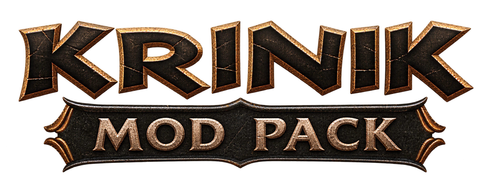

<!-- krinik-game: 3.1.1 CL-383549 -->
<!--
  The first line is the launcher's marker: it matches this release to the game (modpack.json launcher.gameVersion 3.1.1, builtFor CL-383549). Keep it the FIRST line.
  This file is the body of the GitHub release page: a paragraph is ONE line (GitHub Releases keeps single line breaks).
  Check before publishing: no two non-empty lines in a row outside lists and tables.
  The FINAL 0.9.1 (the owner 2026-11-23 13:47 «собирать не пятого кандидата, а финальный релиз 0.9.1» · 13:51 «релиз ноутсы полностью поднобно написать, как
  было в RC1 но с учетом всех правок»; 0.9.1 gets no later update, the next version is 1.0.0 — 13:48). The RC1 form of 2026-11-20 16:2x (every big work with
  its facts and numbers) with every change of RC2–RC4 and of the final folded in: the launcher section is the guide's (guide-3.1.1.html «Лаунчер 1.1.2», one
  text in both places — HOUSE_RULES 42); «Исправлено за время тестовых сборок» lists the fixes of RC2 (#3, #11, #12, #33), RC3 (bug 115 / #46), RC4 (#4, #13,
  #21, #48, #49, #51) and the final (#16, #47 / #15, #43, #53). Sources of the numbers: as in RC1 (KUMM testcases/reports 2026-11-09_conan-quickwin-n1-async-navmesh.md,
  2026-11-09_conan-quickwins-shaders-on-load.md, 2026-11-06_conan-quickwin-chaos-queue.md, 2026-11-07_conan-palm-shadow-wpo-bound-fix.md,
  2026-11-09_conan-water-reflections-five-scenes.md, researches/conan-hitch-profiler); 2026-11-23_conan-rc5-fixes.md (the view switch ≈ 1 ms, three walks
  ≈ 3–4.5 ms; 12.8 GB of the game's copies — issue #16); the plaque: the owner saw its first open still slow on 1.1.2 (2026-11-23 14:27) — a known issue, not a fix.
  The release date line is added at publication. make_release.sh step 4b fills {{ARCHIVE_SIZE}} (RU) and {{ARCHIVE_SIZE_EN}} (EN) with the total size of the
  parts in a copy of these notes. The launcher KrinikConanLauncher.exe, the parts Krinik_Mod_Pack_0_9_1.zip.001 … and the per-file assets of the update are
  assets of this release (KUMM plans/55 criterion 8, R7; plans/57 phase 6).
-->

  

<h3 align="center"><em>Krinik Mod Pack 0.9.1 · Conan Exiles Enhanced 3.1.1</em></h3>

## Русский · [English](#english)

**Коротко.** Krinik Mod Pack 0.9.1 — это сборка модов для Conan Exiles Enhanced 3.1.1 (билд CL-383549). Перед версией 0.9.1 вышли тестовые сборки 0.9.1-RC1, 0.9.1-RC2, 0.9.1-RC3 и 0.9.1-RC4. В версию 0.9.1 вошли все их исправления и ещё четыре исправления, сделанные после RC4. Следующей версией сборки будет 1.0.0.

Главное в версии 0.9.1:

- Лаунчер 1.1.2 сам находит игру на компьютере, скачивает сборку с GitHub и устанавливает её. При обновлении сборки лаунчер скачивает только файлы, которые изменились.
- Новый мод KrinikConanEngineTweaks устраняет три причины, по которым игра замирала на миг.
- Тени от листвы почти не мерцают, и солнце движется по небу плавно.
- Вода отражает дальний берег, скалы и арки.
- Атрибуты героя прокачиваются без предела.
- С новым модом KrinikConanLocomotion герой отталкивается прыжком от стен и бежит спринтом с натянутым луком.

Ниже перечислено то, что изменилось с версии 0.9.0. Возможности сборки, её состав, авторы модов и правообладатели описаны в [README](https://github.com/MikalaiKryvusha/Kriniks_Conan_Exiles_Enhanced_ModPack). Руководство пользователя `Krinik-Conan-3.1.1-guide.pdf` приложено к выпуску и лежит в архиве сборки.

---

### ✨ Что нового в 0.9.1

**Игра 3.1.1**

Сборка перешла на Conan Exiles Enhanced 3.1.1 (билд CL-383549).

**Лаунчер 1.1.2**

Лаунчер KrinikConanLauncher обновлён до версии 1.1.2 и ставит сборку сам, от начала до конца. Он находит игру на компьютере, скачивает файлы сборки с GitHub, проверяет каждый файл и устанавливает сборку. Пока идут скачивание и установка, лаунчер показывает, сколько процентов готово, скорость, сколько времени прошло и сколько осталось. Если скачивание прервалось, лаунчер продолжит его с того места, где оно остановилось.

Когда выходит новая версия сборки или самого лаунчера, лаунчер сообщает о ней в своём окне, и поставить новую версию можно одной кнопкой: «Обновить сборку» или «Обновить лаунчер». При обновлении сборки лаунчер скачивает только файлы, которые изменились, даже если игрок пропустил несколько выпусков. Настройки и сохранения игрока после обновления сборки остаются на месте. Кнопка «Что нового» под версией игры открывает новость об обновлении игры в Steam, а кнопка под версией сборки открывает описание последнего выпуска сборки на GitHub. Если игра упала, лаунчер при следующем запуске предлагает собрать отчёт и открывает на GitHub форму нового сообщения в разделе Issues.

Лаунчер поддерживает мультиязычность: в поле «Язык окна» можно выбрать русский или английский.

**Производительность**

Автор сборки проследил профилировщиком, чем занят движок в те мгновения, когда игра замирает, и нашёл три причины таких замираний. Все три устраняет новый мод сборки KrinikConanEngineTweaks: он меняет настройки движка в файле `Engine.ini`. Каждую правку автор проверял отдельно: облетал мир по одному маршруту несколько раз, попеременно с правкой и без неё. Замиранием в этих замерах считается кадр дольше 50 мс.

- Данные о местности, по которым NPC ищут путь, движок теперь собирает в фоновых потоках. В игре без сборки этим занят игровой поток, и в полёте над миром сбор отнимает у него около четверти времени. С правкой замираний стало на 48 % меньше, а самый долгий кадр сократился на 43 %. Показатель 1 % low (средняя частота самых медленных кадров) вырос на 12 %.
- Шейдеры визуальных эффектов Niagara движок теперь готовит заранее, когда загружает эффект. Замираний стало на 31 % меньше.
- Когда в мир подгружается много объектов, физический движок Chaos теперь перестраивает свою структуру поиска столкновений по частям за несколько кадров. В игре без сборки он перестраивает её целиком за один кадр, как только в очереди набирается больше 1000 изменений. Замираний стало на 28 % меньше.

Сборка снижает дальность прорисовки с 2,0 до 1,5. Кадров в секунду стало примерно на 5 % больше, а картинка почти не изменилась.

**Тени и движение солнца**

В Conan Exiles Enhanced тени от листьев пальм и другой листвы мерцают, когда солнце движется по небу. В сборке 0.9.0 солнце сдвигалось редкими шагами, чтобы тени не мерцали, и раз в несколько секунд тени скачком меняли положение. Автор сборки нашёл причину мерцания в материале листвы самой игры. В материале не задано, насколько далеко ветер отклоняет листья, и в части кадров отклонённые ветром листья пропадают из тени. Мод KrinikConanGraphics исправляет материал листвы. Теперь солнце и тени движутся плавно, без скачков, и тени почти не мерцают. Под пальмой на ветру мерцало от 12 % до 16 % точек тени на земле, а после правки мерцает меньше 0,5 %.

**Отражения в воде**

Сборка строит отражения в воде программным Lumen, системой освещения Unreal Engine 5, и увеличивает дальность его лучей. Вода отражает дальний берег, скалы и арки, и отражение не рвётся за стволами пальм. Аппаратная трассировка лучей для таких отражений не нужна, а частота кадров с ними снижается примерно на 1,5 %.

**Прыжки и бег с луком**

Новый мод автора сборки KrinikConanLocomotion учит героя новым движениям. Герой бьёт оружием ближнего боя в прыжке и бежит спринтом с натянутым луком. Со стены, на которую он лезет, герой отталкивается прыжком и в полёте после такого прыжка стреляет из лука. Пока герой висит на стене, он понемногу тратит запас сил.

**Развитие героя**

Атрибуты героя теперь прокачиваются без предела: в каждый можно вложить больше 20 очков. Шкала атрибута показывает очки страницами по 20 и листается стрелками под шкалой или колесом мыши. Для каждого уровня герою нужно вдвое больше опыта, чем в версии 0.9.0. Сборка ослабила черту Проворства «Верная рука»: с ней стрелы и метательное оружие летят на 20 % быстрее, а в игре без сборки вдвое быстрее.

**Интерфейс, перевод и обои**

- Подсказки, которые появляются у собеседника, постройки, раба и раненого союзника, стали меньше, сдвинулись левее героя и получили более прозрачный фон, как подсказка у трупа.
- Значки голода, жажды и веса мигают в одном ритме.
- Мод ModControlPanel убран из сборки. Настройки Less Building Placement Restrictions теперь открываются из пункта «Прочее» списка «Настройки модов».
- В загоне для животных Emberlight, на панели администратора Ironlight-Settlements и в настройках Pickup+ на русский язык переведены надписи, которые оставались английскими. В окне зачарования и в меню администратора Enhanced Armory and Arsenal, в окне новой метки Simple Minimap и в настройках возрождения Al-Merayah Reborn русский текст теперь помещается в свои кнопки и поля.
- В архиве лежат новые обои для рабочего стола: V2 «Тёплый», V2 «Реализм», V2 female beta «Реализм» и V2 female beta «Тёплый». Каждый вариант есть в разрешениях 4K, 2K и 1080p.

**Исправлено**

- Сборка устранила причину, по которой игра изредка падала, когда игрок щёлкал мышью или нажимал Esc в окне мода сборки, а также когда герой убивал врага из лука.
- Крафт, начатый в открытом хабе, после закрытия хаба идёт с обычной скоростью. В версии 0.9.0 вся очередь крафта заканчивалась мгновенно.
- Вкладка «Путешествие» в хабе обновляется каждый раз, когда появляется на экране, и сразу показывает только что открытые путешествия.
- Семь боссов вновь можно оглушить и взять в рабы: раньше этому мешал конфликт модов.
- От первого лица видно, как герой держит лук, когда смотрит вниз.
- Полоска здоровья над врагом больше не закрывает его самого и поднята чуть выше значка черепа.
- Над трупом в кустах теперь видна одна подсказка, без второй подсказки «E Взять».
- Описания черт на вкладке «Хар-ки» больше не наползают друг на друга и прокручиваются колесом мыши.
- При переключении вкладок хаба по экрану больше не пробегает тёмная волна. Когда игрок переходит на вкладку «Снаряжение» или уходит с неё, сквозь страницу хаба больше не виден игровой мир.

**Исправлено за время тестовых сборок**

Эти ошибки нашлись в тестовых сборках 0.9.1-RC1 – 0.9.1-RC4, и в версии 0.9.1 они исправлены.

- Метка на карте в хабе встаёт туда, где щёлкнул игрок, вторая метка ставится, и сброс меток работает.
- На вкладке «Путешествие» кнопка начала путешествия запускает его, и вкладка больше не показывает закрытыми те путешествия, которые уже открылись.
- Пока открыт разговор с NPC, мир идёт с обычной скоростью. Раньше во время разговора мир замирал, как в меню.
- Когда игрок выбрал реплику в разговоре, текст ответа NPC появляется на экране вместе с голосом.
- В виде от первого лица тень героя целая, с головой.
- В виде от первого лица оружие за спиной героя не попадает в кадр, и тень оружия по-прежнему падает на землю.
- После экрана загрузки при входе в подземелье и при выходе из него мир идёт с обычной скоростью. Раньше сборка принимала такой экран загрузки за открытое меню и ставила игру на паузу.
- Пока герой мёртв, моды KrinikConanLocomotion и KrinikConanArchery не пишут ошибок в журнал UE4SS.
- Мод KrinikConanCamera быстрее переключает вид от первого лица на вид от третьего лица и обратно. Раньше мод при каждом переключении трижды перебирал все части модели героя, и переключение занимало 3–4,5 мс процессорного времени. Теперь мод перебирает части модели героя один раз, и переключение занимает около 1 мс.
- Удаляя сборку, лаунчер теперь стирает и копии её паков (файлов модов), которые игра сама делает в папке `ConanSandbox/Saved/ExtractedMods`. Раньше эти копии оставались в папке игры и занимали около 12,8 ГБ. Копии тех паков, которые игрок поставил сам, лаунчер не трогает.
- Когда удаление закончилось и окно удаления закрыли крестиком, лаунчер видит игру без сборки и показывает кнопку «Установить сборку». Раньше в этом случае лаунчер показывал сборку установленной.
- Строка «Моды» лаунчера к концу установки доходит до «74 из 74». Раньше лаунчер останавливал её на «72 из 74», хотя все 74 мода были установлены: лаунчер не узнавал два мода с длинным тире в названии, «MSCasaDesFlores — Weapons & Armors» и «MSCasaDesFlores — Nails Station».

---

### ⚠️ Известные проблемы

- В сумерках свет и небо иногда меняются скачком.
- При переключении между вкладками «Параметры» и «Снаряжение» хаб примерно на десятую долю секунды показывает тёмный фон, пока игра готовит новую вкладку.
- Текст на вкладках меню слегка дрожит при переключении.
- Когда герой забирает предмет клавишей F, рамка выбора в окне быстрой добычи иногда прыгает в последнюю клетку.
- В окнах настроек некоторых модов русский текст местами не помещается в кнопки и поля, например в окне «Система аксессуаров».
- Названия и описания классов на карточках Enhanced Armory and Arsenal остались английскими: текст нарисован прямо на картинках.
- В обучении маркерам Simple Minimap строки появляются с большой задержкой, а место под слайды остаётся чёрным.
- Первое открытие таблички «Как прислать отзыв или отчёт о падении» после запуска лаунчера идёт медленно.

Все известные ошибки сборки, и крупные, и мелкие, перечислены в разделе [Issues](https://github.com/MikalaiKryvusha/Kriniks_Conan_Exiles_Enhanced_ModPack/issues) репозитория сборки. Там же можно сообщить о новой ошибке.

### 🗺️ Планы на 1.0.0

- Исправить каждую проблему из списка выше.
- Сделать так, чтобы пункт «Моды Xevyr'а» в списке «Настройки модов» открывал общее окно с настройками всех модов Xevyr'а.
- Проверить каждое окно сборки в разрешениях 720p, 1080p, 2K и 4K.
- Замерить, насколько моды сборки нагружают игру в бою и в пути.
- Проверить, что долгая игра идёт без вылетов.

---

### 📦 Установка

1. Убедитесь, что установлена игра Conan Exiles Enhanced 3.1.1 (билд CL-383549).
2. Скачайте из списка **Assets** внизу страницы лаунчер `KrinikConanLauncher.exe` и запустите его. Лаунчер сам найдёт игру на компьютере.
3. Нажмите «Установить сборку». Лаунчер скачает файлы сборки, проверит их и установит сборку.
4. Нажмите «Играть».

Если лаунчер не нашёл игру, нажмите «Указать папку игры» и выберите папку, где лежит `ConanSandbox.exe`. Части архива `Krinik_Mod_Pack_0_9_1.zip.001`, `Krinik_Mod_Pack_0_9_1.zip.002` и следующие, всего {{ARCHIVE_SIZE}}, можно скачать и самому. Положите их в ту же папку, где лежит лаунчер, и лаунчер установит сборку из них, ничего не скачивая.

Сборку можно поставить и прямо из архива. Проводник Windows не открывает архив, разбитый на части. Откройте первую часть, `Krinik_Mod_Pack_0_9_1.zip.001`, в 7-Zip или WinRAR и распакуйте сборку в папку игры, где лежит `ConanSandbox.exe`. Затем запустите `KrinikConanLauncher.exe` из папки сборки `Krinik_Mod_Pack_0_9_1`, которая появится в папке игры, и нажмите «Установить сборку».

Если у вас установлена одна из тестовых сборок 0.9.1-RC1 – 0.9.1-RC4, запустите её лаунчер. Лаунчер покажет плашку «Вышел лаунчер 1.1.2». Нажмите на плашке кнопку «Обновить лаунчер». Когда лаунчер обновится, нажмите кнопку «Обновить сборку».

Чтобы удалить сборку, закройте игру, запустите `KrinikConanLauncher.exe`, нажмите «Удалить сборку» и подтвердите удаление. Игра вернётся в то состояние, в котором была до установки сборки.

### 💬 Отзывы

Отзывы, вопросы, сообщения о сбоях и предложения присылайте автору сборки по электронной почте [kotkrinik@yandex.ru](mailto:kotkrinik@yandex.ru) или сообщением в разделе [Issues](https://github.com/MikalaiKryvusha/Kriniks_Conan_Exiles_Enhanced_ModPack/issues) репозитория сборки. Если игра вылетела, зависла или мод в ней работает неправильно, приложите к сообщению отчёт. Чтобы собрать отчёт, нажмите кнопку «Отзыв» в главном меню игры или в меню Esc и дождитесь, пока на рабочем столе появится файл `Conan-report-<дата>_<время>.zip`. Если игра упала, лаунчер при следующем запуске сам предложит собрать отчёт и откроет новое сообщение в разделе Issues.

### 🔗 Ссылки

- Почта: [kotkrinik@yandex.ru](mailto:kotkrinik@yandex.ru)
- Страница сборки на Nexus Mods: [nexusmods.com/conanexilesenhanced/mods/65](https://www.nexusmods.com/conanexilesenhanced/mods/65)
- Публичный репозиторий сборки на GitHub: [github.com/MikalaiKryvusha/Kriniks_Conan_Exiles_Enhanced_ModPack](https://github.com/MikalaiKryvusha/Kriniks_Conan_Exiles_Enhanced_ModPack)

---

## English · [Русский](#русский)

**In short.** Krinik Mod Pack 0.9.1 is a mod pack for Conan Exiles Enhanced 3.1.1 (build CL-383549). The test builds 0.9.1-RC1, 0.9.1-RC2, 0.9.1-RC3 and 0.9.1-RC4 came out before version 0.9.1. Version 0.9.1 includes all of their fixes and four more fixes made after RC4. The next version of the pack will be 1.0.0.

The highlights of 0.9.1:

- Launcher 1.1.2 finds the game on your computer, downloads the pack from GitHub and installs it. A pack update makes the launcher download only the files that changed.
- The new mod KrinikConanEngineTweaks fixes three causes of the brief freezes in the game's engine.
- Foliage shadows hardly flicker any more, and the sun moves smoothly across the sky.
- The water reflects the far shore, the cliffs and the arches.
- Hero attributes have no cap.
- With the new mod KrinikConanLocomotion the hero pushes off walls with a jump and sprints with a drawn bow.

The changes since 0.9.0 are listed below. The [README](https://github.com/MikalaiKryvusha/Kriniks_Conan_Exiles_Enhanced_ModPack) describes what the pack does and what it contains, and names the mod authors and the rights holders. The user guide `Krinik-Conan-3.1.1-guide.pdf` (in Russian) is attached to this release and is also included in the pack archive.

---

### ✨ What's new in 0.9.1

**Game 3.1.1**

The pack now runs on Conan Exiles Enhanced 3.1.1 (build CL-383549).

**Launcher 1.1.2**

The launcher, KrinikConanLauncher, has been updated to version 1.1.2 and installs the pack on its own from start to finish. It finds the game on your computer, downloads the pack's files from GitHub, verifies every file and installs the pack. It shows the download and installation progress as a percentage together with the speed, the time elapsed and the time left. An interrupted download resumes where it left off.

When a new version of the pack or of the launcher itself is out, the launcher tells you in its window, and each one installs with a single button: “Update mod pack” or “Update launcher”. A pack update downloads only the files that changed, even if you skipped several releases. Your settings and saves stay in place after a pack update. The “What's new” buttons under the game and pack versions open the game update's news post on Steam and the description of the latest pack release on GitHub. If the game crashes, the launcher offers to collect a report the next time it starts and opens a new issue on GitHub.

The launcher supports several languages: pick Russian or English in the “Window language” field.

**Performance**

The pack author recorded a profile of the engine's work in the frames where the game freezes for a moment and found three causes of these freezes. The new mod KrinikConanEngineTweaks removes all three by changing engine settings in `Engine.ini`. The author tested each fix on its own, on the same flight route over the world, comparing the game with and without the fix over several alternating flights. A freeze here is a frame longer than 50 ms.

- The engine now gathers the terrain data that NPCs use to find their path on background threads. In the game without the pack this gathering runs on the game thread and takes about a quarter of its time during a flight over the world. With the fix there are 48 percent fewer freezes, the longest frame is 43 percent shorter, and the 1 % low frame rate (the frame rate over the slowest 1 % of frames) is 12 percent higher.
- The engine now prepares the shaders of Niagara visual effects in advance, when it loads an effect. There are 31 percent fewer freezes.
- When many objects stream into the world, the Chaos physics engine now rebuilds its collision search structure in parts over several frames. In the game without the pack it rebuilds the whole structure in a single frame as soon as more than 1000 changes are queued. There are 28 percent fewer freezes.

The draw distance is lowered from 2.0 to 1.5. The game shows about 5 percent more frames per second, and the picture looks almost the same.

**Shadows and the sun**

In Conan Exiles Enhanced the shadows of palm leaves and other foliage flicker while the sun moves across the sky. Pack 0.9.0 moved the sun in rare steps to hide the flicker, so the shadows jumped after the sun every few seconds. The pack author found the cause of the flicker in the game's own foliage material. The material does not tell the engine how far the wind bends the leaves, and on some frames the engine drops the bent leaves from the shadow. The KrinikConanGraphics mod fixes the foliage material. The sun and the shadows now move smoothly, without jumps, and the foliage shadows hardly flicker any more. Under a palm in the wind, 12–16 percent of the shadow's pixels on the ground used to flicker; after the fix, fewer than 0.5 percent do.

**Water reflections**

Water reflections are now computed by software Lumen, the lighting system of Unreal Engine 5, with a longer ray reach. The water reflects the far shore, the cliffs and the arches, and the reflection does not break behind palm trunks. These reflections need no hardware ray tracing and lower the frame rate by about 1.5 percent.

**Jumps and running with a bow**

KrinikConanLocomotion, a new mod by the pack author, gives the hero new moves. The hero strikes with a melee weapon mid-jump, sprints with a drawn bow, jumps off a wall while climbing it and can shoot the bow in mid-air after that jump. Hanging on a wall slowly drains the hero's stamina.

**Hero progression**

Hero attributes have no cap: each attribute can take more than 20 points. An attribute bar shows the points in pages of 20, and you page it with the arrows under the bar or with the mouse wheel. Each level now takes twice as much experience as in 0.9.0. The pack weakens the Agility perk “Верная рука” (Dead Shot): with it, arrows and thrown weapons fly 20 percent faster, while in the game without the pack they fly twice as fast.

**Interface, translation and wallpapers**

- The interaction prompts for a person to talk to, a building, a thrall and a downed ally are smaller, sit to the left of the hero and have a more transparent background, like the corpse prompt.
- The hunger, thirst and weight icons blink in sync.
- The ModControlPanel mod has been removed from the pack. The settings of Less Building Placement Restrictions now open from “Прочее” (Other) in the “Настройки модов” (Mod settings) list.
- Labels that were still in English are now in Russian in the Emberlight animal pen, on the Ironlight-Settlements admin panel and in the Pickup+ settings. The Russian text now fits its buttons and fields in the enchanting window and the admin menu of Enhanced Armory and Arsenal, in the new-marker window of Simple Minimap and in the respawn settings of Al-Merayah Reborn.
- New desktop wallpapers: V2 “Тёплый” (Warm), V2 “Реализм” (Realism), V2 female beta “Реализм” (Realism) and V2 female beta “Тёплый” (Warm). The archive has each of them in 4K, 2K and 1080p.

**Fixed**

- Removed the cause of a rare game crash that could happen when you clicked or pressed Esc in a mod window of the pack, or when the hero killed an enemy with a bow.
- Crafting started while the hub is open keeps its normal speed after the hub is closed. In 0.9.0 the whole crafting queue finished instantly.
- The “Путешествие” (Journey) tab of the hub refreshes every time it is shown and lists newly unlocked journeys right away.
- Seven bosses can once again be knocked out and taken as thralls; a mod conflict had taken this away.
- In first-person view the bow is visible in the hero's hands when the hero holds it and looks down.
- An enemy's health bar no longer covers the enemy and sits slightly above the skull icon.
- Over a corpse in bushes, only the corpse prompt appears, without a second “E Взять” (E Take) prompt.
- Perk descriptions on the “Хар-ки” (Attributes) tab no longer overlap and scroll with the mouse wheel.
- Switching hub tabs no longer sends a dark wave across the screen. Switching to or from the “Снаряжение” (Equipment) tab no longer lets the game world show through the hub page.

**Fixed during the test builds**

These bugs were found in the test builds 0.9.1-RC1 to 0.9.1-RC4, and version 0.9.1 fixes them.

- A marker on the hub map lands where you clicked, a second marker can be placed, and resetting the markers works.
- On the “Путешествие” (Journey) tab the button that starts a journey starts it, and the tab no longer shows journeys that are already open as closed.
- While a conversation with an NPC is open, the world keeps its normal pace. Before, the world froze during a conversation, as it does in a menu.
- After you pick a line in a conversation, the NPC's answer appears on screen together with the voice.
- In first-person view the hero casts a whole shadow, head included.
- In first-person view a weapon on the hero's back stays out of the frame, and it still casts its shadow on the ground.
- After the loading screen on entering or leaving a dungeon, the world runs at its normal pace. The pack used to take such a loading screen for an open menu and pause the game.
- While the hero is dead, the KrinikConanLocomotion and KrinikConanArchery mods write no errors to the UE4SS log.
- The KrinikConanCamera mod switches between first-person and third-person view faster. Before, the mod went through every part of the hero's model three times on every switch, and a switch took 3–4.5 ms of CPU time. The mod now goes through them once, and a switch takes about 1 ms.
- When it uninstalls the pack, the launcher now also deletes the copies of the pack's paks (mod files) that the game makes on its own in `ConanSandbox/Saved/ExtractedMods`. These copies, about 12.8 GB, used to stay in the game folder. Copies of the paks you installed yourself are left alone.
- When the uninstall has finished and its window is closed with the cross, the launcher sees the game without the pack and shows the “Install mod pack” button. Before, the launcher showed the pack as installed in this case.
- The launcher's “Mods” line reaches “74 of 74” at the end of an install. Before, the launcher stopped it at “72 of 74”, although all 74 mods had been installed: the launcher did not recognise two mods with a long dash in their names, “MSCasaDesFlores — Weapons & Armors” and “MSCasaDesFlores — Nails Station”.

---

### ⚠️ Known issues

- At dusk the light and the sky sometimes change abruptly.
- Switching between the “Параметры” (Character) and “Снаряжение” (Equipment) hub tabs shows a dark background for about a tenth of a second while the game builds the new tab.
- The text on the menu tabs jitters slightly while switching.
- When the hero takes an item with F, the selection frame in the quick loot window sometimes jumps to the last cell.
- In the settings windows of some mods the Russian text does not always fit the buttons and fields, for example in the “Система аксессуаров” (Accessory system) window.
- Class names and descriptions on the Enhanced Armory and Arsenal cards are still in English: the text is baked into the images.
- In the Simple Minimap marker tutorial the lines appear with a long delay, and the slide area stays black.
- The first open of the “How to send feedback or a crash report” panel after the launcher starts is slow.

Every known bug of the pack, large or small, is listed in the [Issues](https://github.com/MikalaiKryvusha/Kriniks_Conan_Exiles_Enhanced_ModPack/issues) section of the pack repository. You can report a new bug there too.

### 🗺️ Plans for 1.0.0

- Fix every issue in the list above.
- Make the “Моды Xevyr'а” (Xevyr's mods) entry in the “Настройки модов” (Mod settings) list open one window with the settings of all of Xevyr's mods.
- Check every window of the pack at 720p, 1080p, 2K and 4K.
- Measure the performance cost of the pack's mods in combat and while traveling.
- Check that a long play session runs without crashes.

---

### 📦 Installation

1. Make sure Conan Exiles Enhanced 3.1.1 (build CL-383549) is installed.
2. Download the launcher `KrinikConanLauncher.exe` from the **Assets** list at the bottom of this page and run it. The launcher finds the game on your computer by itself.
3. Press “Install mod pack”. The launcher downloads the pack's files, verifies them and installs the pack.
4. Press “Play”.

If the launcher cannot find the game, press “Choose game folder” and pick the folder that contains `ConanSandbox.exe`. You can also download the archive parts `Krinik_Mod_Pack_0_9_1.zip.001`, `Krinik_Mod_Pack_0_9_1.zip.002` and the rest ({{ARCHIVE_SIZE_EN}} in total) manually: put them in the same folder as the launcher, and the launcher installs the pack from them without downloading anything.

You can also install the pack straight from the archive. Windows Explorer cannot open the parts of this archive, so open the first part, `Krinik_Mod_Pack_0_9_1.zip.001`, in 7-Zip or WinRAR and extract the pack into the game folder, the one that contains `ConanSandbox.exe`. Then run `KrinikConanLauncher.exe` from the pack folder `Krinik_Mod_Pack_0_9_1` that appears in the game folder, and press “Install mod pack”.

If you have one of the test builds 0.9.1-RC1 to 0.9.1-RC4, run its launcher. The launcher shows the notice “Launcher 1.1.2 is out”. Press “Update launcher” on the notice. When the launcher has updated, press “Update mod pack”.

To remove the pack, close the game, run `KrinikConanLauncher.exe`, press “Remove mod pack” and confirm. The game returns to the state it was in before the pack was installed.

### 💬 Feedback

Send feedback, questions, crash reports and suggestions to the pack author by email at [kotkrinik@yandex.ru](mailto:kotkrinik@yandex.ru) or as an issue in the [Issues](https://github.com/MikalaiKryvusha/Kriniks_Conan_Exiles_Enhanced_ModPack/issues) section of the pack repository. If the game crashes or freezes, or a mod misbehaves, attach a report to your message. To collect a report, press the “Отзыв” (Feedback) button in the game's main menu or in the Esc menu and wait until `Conan-report-<date>_<time>.zip` appears on your desktop. If the game crashes, the launcher offers to collect a report the next time it starts and opens a new issue for you.

### 🔗 Links

- Email: [kotkrinik@yandex.ru](mailto:kotkrinik@yandex.ru)
- Pack page on Nexus Mods: [nexusmods.com/conanexilesenhanced/mods/65](https://www.nexusmods.com/conanexilesenhanced/mods/65)
- Public repository of the pack on GitHub: [github.com/MikalaiKryvusha/Kriniks_Conan_Exiles_Enhanced_ModPack](https://github.com/MikalaiKryvusha/Kriniks_Conan_Exiles_Enhanced_ModPack)

---

Лицензия MIT, © 2026 <b>Mikalai Kryvusha</b> aka <b>KOT KRINIK</b> · Николай Кривуша aka Кот Криник. Моды других авторов принадлежат своим правообладателям, которые названы в <a href="https://github.com/MikalaiKryvusha/Kriniks_Conan_Exiles_Enhanced_ModPack">README</a>.

MIT license, © 2026 <b>Mikalai Kryvusha</b> aka <b>KOT KRINIK</b>. Mods by other authors belong to their rights holders, who are named in the <a href="https://github.com/MikalaiKryvusha/Kriniks_Conan_Exiles_Enhanced_ModPack">README</a>.

