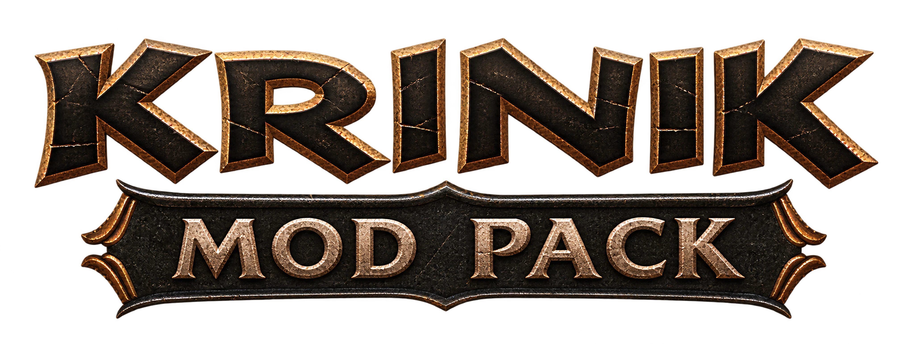

<!--
  This file is the body of the GitHub release page: a paragraph is ONE line (GitHub Releases keeps single line breaks).
  Check before publishing: no two non-empty lines in a row outside lists and tables.
-->

  

<h3 align="center"><em>Krinik Mod Pack 0.9.0 · Conan Exiles Enhanced 3.0.1</em></h3>

> **Дата выпуска / Release date: 2026-11-02**

## Русский · [English](#english)

**Коротко.** Krinik Mod Pack превращает Conan Exiles Enhanced в ролевую игру старой школы в духе The Elder Scrolls IV: Oblivion. Камера стоит за спиной героя, стрела летит по дуге в точку прицела, а герой растёт до 10 000 уровня и с каждым уровнем бегает быстрее, прыгает выше и лучше стреляет. Мир стал больше и опаснее: новые земли и подземелья, засады, ночная нежить и сотни новых персонажей. Дома героя ждёт поселение со своим распорядком дня, а в походе за ним идёт отряд до сотни спутников. Вся сборка говорит по-русски, а лаунчер ставит и удаляет её одной кнопкой.

**Krinik Mod Pack 0.9.0 — первый выпуск сборки модов для Conan Exiles Enhanced 3.0.1 (билд CL-379176).** В сборке 7 модов автора, 64 мода других авторов из Мастерской Steam и с Nexus Mods, загрузчик UE4SS и лаунчер. Тексты всех модов переведены на русский язык теми же словами, что и сама игра. Лаунчер ставит, запускает и удаляет сборку, а из меню игры игрок собирает отчёт для автора.

Версия 0.9.0 выходит в том виде, в каком сборка работала 2 ноября 2026 года. Что пока не доделано и что будет исправлено к версии 1.0.0, перечислено ниже и в главе «Известные проблемы и планы на 1.0.0» руководства пользователя.

Состав сборки, авторы модов и правообладатели — в [README](https://github.com/MikalaiKryvusha/Kriniks_Conan_Exiles_Enhanced_ModPack#russian). Руководство пользователя `Krinik-Conan-3.0.1-guide.pdf` приложено к выпуску.

---

### ⚔️ Возможности сборки

- **Камера строго за спиной героя**, как в ролевых играх 2000-х годов. Каждый игрок ставит камеру под себя клавишами цифрового блока, сохраняет её положение и возвращается к нему.
- **Стрельба из лука как в The Elder Scrolls IV: Oblivion.** Стрела уходит в точку прицела по дуге, скорость полёта задаёт сила натяжения. Есть вид от первого лица с луком в руках и стрельба в прыжке.
- **Прокачка героя до 10 000 уровня.** С ростом уровня герой быстрее бегает, выше и дальше прыгает, лучше стреляет.
- **Пауза в инвентаре и хабе.** Добычу можно разобрать спокойно.
- **Поселение и спутники.** За героем идёт отряд до сотни человек, рабы ездят верхом и растут до 50 уровня, в рабы можно взять боссов.
- **Новые земли.** Пещеры Сета, шемитский город-государство, подземелье Ymir's Respite и возрождённая крепость Al-Merayah; по карте героя переносит сеть путевых камней.
- **Опасный мир.** Засады, ночные демоны и нежить, бури, жара и холод, более 700 новых неигровых персонажей.
- **Снаряжение и внешность героя.** Оружие с собственными связками ударов, броня семи религий, руны, новые причёски и облик народов по описаниям Роберта Говарда.
- **Быт и хозяйство базы.** Строительство и крафт из сундуков всей базы, сундук-сортировщик, хранилища двойной вместимости, рыбалка и тысячи предметов декора.
- **Интерфейс.** HUD Hosav, мини-карта, счётчик урона, полоски здоровья спутников; кнопка «Настройки модов» в инвентаре открывает настройки модов сборки.
- **Русификация.** Моды сборки говорят по-русски теми же словами, что и сама игра.

---

### ✨ Что нового в 0.9.0

**Добавлено**

- Моды сборки KrinikConanCamera, KrinikConanArchery, KrinikConanGameplay, KrinikConanUI, KrinikConanGraphics, KrinikConanRussianTranslation и KrinikConanModPackManager.
- Лаунчер KrinikConanLauncher: установка, запуск, руководство пользователя, отчёт для автора и удаление сборки с возвратом игры к состоянию до установки. Под логотипами лаунчера, главного меню и меню Esc стоят версия игры и версия сборки.
- Обои для рабочего стола в разрешениях 4K, 2K и 1080p.

**Изменено**

- На русский язык переведены тексты модов Immersive Warriors Enhanced, Exiles Fishing, Player Ignores Follower Collision, Era of Trials и Ironlight-Settlements: сообщения, окна настроек, умения, места осквернения святилищ и журнал поселения.
- Hosav's Custom UI и Simple Minimap переработаны для лучшей читаемости; координаты мини-карты стоят внутри её кольца.
- С Severe Weather Enhanced ночью горит родной свет игры.
- Метрики сервера в HUD Hosav's Custom UI выключены в настройках по умолчанию.
- Свёрнутый счётчик The Damage Meter уходит в верхний левый угол экрана.

**Исправлено**

- Предметы поднимаются при любом отдалении камеры (благодарность Taurin78 за подсказку).
- Окно быстрой добычи и подсказка у трупа стоят рядом и не накрывают друг друга; подсказка предмета держит одну раскладку.
- Строка координат над мини-картой Simple Minimap видна целиком.
- Список модов Simple Modlist в меню Esc оставляет открытыми нижние строки меню игры.
- Окно выбора стрел Arrow Quick Swap появляется при натяжении лука, только когда у героя стрелы разных видов, и не мерцает. Его выключает строка «Выбор стрел при натяжении» в окне «Моды Krinik'а».
- Эмблема Enhanced Armory and Arsenal на вкладке «Снаряжение» появляется вместе с хабом.
- Кнопки и подписи окон настроек Enhanced Armory and Arsenal, Simple Minimap и The Damage Meter стоят каждая на своём месте.
- В списках появления Ragnar's New Factions каждое место занимает существующий персонаж.

---

### ⚠️ Известные проблемы

- Тени от листьев пальм мерцают.
- Полоски здоровья врагов закрывают самих врагов.
- В сумерках свет и небо иногда меняются скачком.
- Хаб вздрагивает при переключении вкладок клавишами Q и E, и часть элементов модов появляется в нём с задержкой.
- Текст на вкладках меню слегка дрожит при переключении.
- Когда герой забирает предмет клавишей F, рамка выбора в окне быстрой добычи на мгновение прыгает в нижнюю правую клетку.
- Окно быстрой добычи дёргается, если над ним крутить колесо мыши.
- Над трупом в кустах одновременно видны и подсказка у трупа, и «E Взять».
- Над яйцами в гнезде подсказка «E Взять» не появляется, хотя герой берёт их клавишей E.
- В окнах настроек некоторых модов русский текст не помещается в кнопки и поля: в меню школы магии, в окне «Система аксессуаров» и других.
- Описания перков под атрибутом на вкладке «Хар-ки» местами наползают друг на друга.
- Названия и описания классов на карточках Enhanced Armory and Arsenal остались английскими: текст нарисован прямо на картинках.
- В обучении маркерам Simple Minimap строки появляются с большой задержкой, а место под слайды остаётся чёрным.
- В окне ModControlPanel стоит надпись «Нет доступных виджетов»: настроек Less Building Placement Restrictions в нём нет.

### 🗺️ Планы на 1.0.0

- Исправить каждую проблему из списка выше.
- Научить героя прыгать со стены, по которой он лезет.
- Пункт «Моды Xevyr'а» в списке «Настройки модов» будет открывать общее окно с настройками всех модов Xevyr'а.
- Проверить каждое окно сборки в разрешениях 720p, 1080p, 2K и 4K.
- Замерить, насколько моды сборки нагружают игру в бою и в пути.
- Проверить, что долгая игра идёт без вылетов.

---

### 📦 Установка

1. Убедитесь, что установлена игра Conan Exiles Enhanced 3.0.1 (билд CL-379176).
2. Скачайте в одну папку все 7 частей архива из списка **Assets** внизу страницы: с `Krinik_Mod_Pack_0_9_0.zip.001` по `Krinik_Mod_Pack_0_9_0.zip.007`, всего 12,4 ГБ.
3. Откройте первую часть, `Krinik_Mod_Pack_0_9_0.zip.001`, в 7-Zip или WinRAR и распакуйте сборку в папку игры, где лежит `ConanSandbox.exe`.
4. Запустите `KrinikConanLauncher.exe` из папки сборки и нажмите «Установить сборку», затем «Играть».
5. Сборка ставит полноэкранный режим 3840 × 2160. Если разрешение экрана ниже 4K, смените его в настройках игры.

**Удаление:** закройте игру, запустите `KrinikConanLauncher.exe`, нажмите «Удалить сборку» и подтвердите. Игра вернётся к состоянию до установки сборки.

### 💬 Отзывы

Нажмите кнопку «Отзыв» в главном меню игры или в меню Esc, дождитесь файла `Conan-report-<дата>_<время>.zip` на рабочем столе и пришлите его автору вместе с описанием того, что происходило в игре. Почта: [kotkrinik@yandex.ru](mailto:kotkrinik@yandex.ru) · страница сборки на Nexus Mods: [nexusmods.com/conanexilesenhanced/mods/65](https://www.nexusmods.com/conanexilesenhanced/mods/65).

---

## English · [Русский](#русский)

**In short.** Krinik Mod Pack turns Conan Exiles Enhanced into an old-school role-playing game in the spirit of The Elder Scrolls IV: Oblivion. The camera stands behind the hero's back, the arrow flies along an arc to the aim point, and the hero grows up to level 10,000, running faster, jumping higher and shooting better with every level. The world is larger and more dangerous: new lands and dungeons, ambushes, night undead and hundreds of new characters. At home a settlement with its own daily routine waits for the hero, and on the road a party of up to a hundred followers marches with the hero. The whole pack speaks Russian, and the launcher installs and removes it with one button.

**Krinik Mod Pack 0.9.0 is the first release of the mod pack for Conan Exiles Enhanced 3.0.1 (build CL-379176).** The pack holds 7 mods by its author, 64 mods by other authors from the Steam Workshop and Nexus Mods, the UE4SS loader and a launcher. The texts of every mod are translated into Russian in the terms of the game's Russian version. The launcher installs, launches and removes the pack, and a player collects a report for the pack author straight from the game menu.

Version 0.9.0 ships as the pack worked on 2 November 2026. What is not done yet and goes into 1.0.0 is listed below and in the user guide's chapter «Известные проблемы и планы на 1.0.0» (Known issues and plans for 1.0.0).

The contents of the pack, the mod authors and the rights holders are in the [README](https://github.com/MikalaiKryvusha/Kriniks_Conan_Exiles_Enhanced_ModPack#english). The user guide `Krinik-Conan-3.0.1-guide.pdf` (in Russian) is attached to the release.

---

### ⚔️ What the pack does

- **The camera stands strictly behind the hero**, as in the role-playing games of the 2000s. Every player sets the camera from the numeric keypad, saves its position and returns to it.
- **Archery as in The Elder Scrolls IV: Oblivion.** The arrow flies along an arc to the aim point, and the draw strength sets its speed. First-person view with the bow in hand, shooting in a jump.
- **Hero levelling up to level 10,000.** As the level grows, the hero runs faster, jumps higher and farther, and shoots better.
- **Pause in the inventory and the hub.** Loot can be sorted at leisure.
- **Settlement and followers.** A party of up to a hundred people follows the hero, thralls ride on horseback and level up to 50, bosses can be taken as thralls.
- **New lands.** The Caverns of Set, a Shemite city state, the Ymir's Respite dungeon and the reborn Al-Merayah fortress; a network of waystones carries the hero over the map.
- **A dangerous world.** Ambushes, night demons and undead, storms, heat and cold, over 700 new NPCs.
- **Gear and the hero's looks.** Weapons with their own combos, armour of the seven religions, runes, new hairstyles and the peoples' looks after Robert E. Howard's books.
- **Base life and housekeeping.** Building and crafting from the chests of the whole base, a sorting chest, storage of double capacity, fishing and thousands of decor items.
- **Interface.** The Hosav HUD, a minimap, a damage meter, follower health bars; the «Настройки модов» (Mod settings) button in the inventory opens the settings of the pack's mods.
- **Russian translation.** The mods of the pack speak Russian in the same words as the game itself.

---

### ✨ What's new in 0.9.0

**Added**

- The pack's own mods KrinikConanCamera, KrinikConanArchery, KrinikConanGameplay, KrinikConanUI, KrinikConanGraphics, KrinikConanRussianTranslation and KrinikConanModPackManager.
- The KrinikConanLauncher launcher: install, launch, the user guide, a report for the author, and removal of the pack that returns the game to its state before the install. The game version and the pack version stand under the logos of the launcher, the main menu and the Esc menu.
- Desktop wallpapers in 4K, 2K and 1080p.

**Changed**

- The texts of Immersive Warriors Enhanced, Exiles Fishing, Player Ignores Follower Collision, Era of Trials and Ironlight-Settlements are translated into Russian: messages, settings windows, skills, shrine desecration sites and the settlement log.
- Hosav's Custom UI and Simple Minimap are reworked for readability; the minimap coordinates stand inside its ring.
- With Severe Weather Enhanced the game's own light burns at night.
- The server metrics in the Hosav's Custom UI HUD are off by default.
- The collapsed counter of The Damage Meter moves to the top left corner of the screen.

**Fixed**

- Items are picked up at any camera distance (thanks to Taurin78 for the hint).
- The quick loot window and the corpse prompt stand side by side and do not cover each other; the item tooltip keeps one layout.
- The coordinate line above the Simple Minimap minimap is shown in full.
- The Simple Modlist mod list in the Esc menu leaves the bottom rows of the game menu open.
- The Arrow Quick Swap arrow choice window appears on a bow draw only when the hero carries arrows of different kinds, and does not flicker. The row «Выбор стрел при натяжении» (Arrow choice on draw) in the «Моды Krinik'а» (Krinik's mods) window turns it off.
- The Enhanced Armory and Arsenal emblem on the Equipment tab appears together with the hub.
- The buttons and labels of the settings windows of Enhanced Armory and Arsenal, Simple Minimap and The Damage Meter each stand in their own place.
- In the spawn lists of Ragnar's New Factions every slot holds an existing character.

---

### ⚠️ Known issues

- Palm leaf shadows flicker.
- Enemy health bars cover the enemies themselves.
- At dusk the light and the sky sometimes change in a jump.
- The hub shakes when tabs are switched with Q and E, and some mod elements appear in it late.
- The text on the menu tabs trembles slightly when switching.
- When the hero takes an item with F, the selection frame in the quick loot window jumps to the bottom right cell for a moment.
- The quick loot window jerks when the mouse wheel is turned over it.
- Over a corpse in bushes both the corpse prompt and «E Взять» (E Take) show at once.
- Over eggs in a nest the «E Взять» (E Take) prompt does not show, although the hero takes them with E.
- In the settings windows of some mods the Russian text does not fit into buttons and fields: the magic school menu, the «Система аксессуаров» (Accessory system) window and others.
- Perk descriptions under an attribute on the «Хар-ки» (Attributes) tab overlap in places.
- Class names and descriptions on the Enhanced Armory and Arsenal cards stay in English: the text is painted into the images.
- In the Simple Minimap marker tutorial the lines appear with a long delay, and the slide area stays black.
- The ModControlPanel window reads «Нет доступных виджетов» (No widgets available): the settings of Less Building Placement Restrictions are not in it.

### 🗺️ Plans for 1.0.0

- Fix every issue in the list above.
- Teach the hero to jump off a wall he is climbing.
- The «Моды Xevyr'а» (Xevyr's mods) entry in the «Настройки модов» (Mod settings) list will open one window with the settings of all Xevyr's mods.
- Check every window of the pack at 720p, 1080p, 2K and 4K.
- Measure how much the pack's mods load the game in combat and on the road.
- Check that a long play session runs without crashes.

---

### 📦 Installation

1. Make sure Conan Exiles Enhanced 3.0.1 (build CL-379176) is installed.
2. Download all 7 archive parts from the **Assets** list at the bottom of this page into one folder: `Krinik_Mod_Pack_0_9_0.zip.001` to `Krinik_Mod_Pack_0_9_0.zip.007`, 12.4 GB in total.
3. Open the first part, `Krinik_Mod_Pack_0_9_0.zip.001`, in 7-Zip or WinRAR and unpack the pack into the game folder, the one that holds `ConanSandbox.exe`.
4. Run `KrinikConanLauncher.exe` from the pack folder and press «Установить сборку» (Install the pack), then «Играть» (Play).
5. The pack sets the game to fullscreen 3840 × 2160. If your screen resolution is below 4K, change it in the game settings.

**Removal:** close the game, run `KrinikConanLauncher.exe`, press «Удалить сборку» (Remove the pack) and confirm. The game returns to its state before the pack was installed.

### 💬 Feedback

Press the «Отзыв» (Feedback) button in the main menu of the game or in the Esc menu, wait for `Conan-report-<date>_<time>.zip` on the desktop and send it to the pack author together with a description of what happened in the game. Email: [kotkrinik@yandex.ru](mailto:kotkrinik@yandex.ru) · the pack page on Nexus Mods: [nexusmods.com/conanexilesenhanced/mods/65](https://www.nexusmods.com/conanexilesenhanced/mods/65).

---

MIT — © 2026 <b>Mikalai Kryvusha</b> aka <b>KOT KRINIK</b> · Николай Кривуша aka Кот Криник. Mods by other authors belong to their rights holders — see the <a href="https://github.com/MikalaiKryvusha/Kriniks_Conan_Exiles_Enhanced_ModPack#7-rights-holders-and-disclaimer">README</a>.

