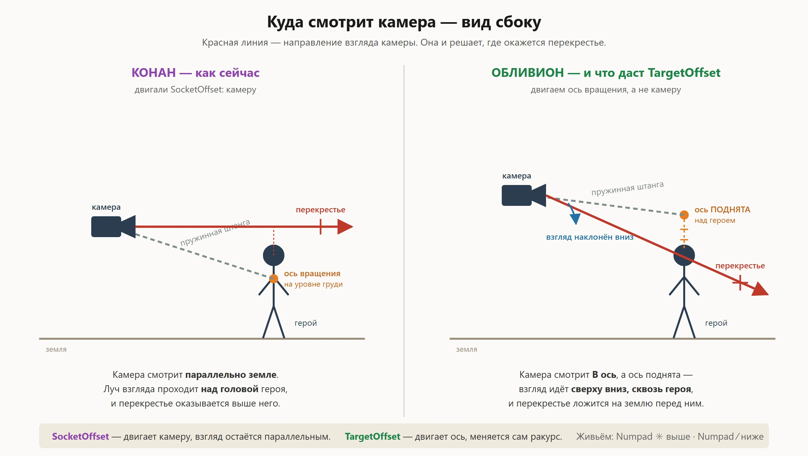

# ConanCameraControl — камера за спиной, для Conan Exiles Enhanced

Наш собственный мод. Готового такого нет нигде — перепроверено по всем 40 модам Nexus Enhanced,
Мастерской Steam, ModDB и GitHub.

**Что делает:** держит камеру строго за спиной вместо вида из-за плеча, отбирает у игры управление
зумом, лечит дрожь и переживает смерть героя. Всё настраивается прямо в игре, с цифрового блока,
и запоминается само.

---

## Раскладка цифрового блока

Читается по самому блоку: где клавиша стоит — туда и двигает.

```
        7 8 9        8 / 2  — камера назад / вперёд
        4 5 6        4 / 6  — камера влево / вправо
        1 2 3        9 / 3  — камера выше / ниже
                     7 / 1  — ОСЬ выше / ниже
```

| клавиша | что делает |
|---|---|
| **8** / **2** | камера дальше / ближе по горизонтали |
| **4** / **6** | камера влево / вправо |
| **9** / **3** | камера выше / ниже |
| **7** / **1** | **ось вращения** выше / ниже — меняет РАКУРС (см. ниже) |
| **5** | **строго за спиной** — обнулить боковое смещение. То, ради чего мод |
| **0** | **применить записанную посадку** |
| **/** | **записать нынешнюю посадку** |
| **+** / **−** | дистанция до героя |
| **.** | зонд дождя — снимает числа системы осадков в журнал |

С **Ctrl** те же клавиши двигают **ось вращения**, а не камеру:

| клавиша | что делает |
|---|---|
| **Ctrl + 8 / 2** | ось вперёд / назад |
| **Ctrl + 4 / 6** | ось влево / вправо |
| **Ctrl + 9 / 3** | ось выше / ниже (то же, что 7 / 1) |
| **Ctrl + 5** | обнулить ось — вернуть штатный ракурс игры |
| **Ctrl + 0** | пересобрать поиск камеры — аварийная кнопка, если мод потерял штангу |
| **Ctrl + 7** | зонд настроек камеры |
| **Ctrl + .** | переключатель охвата съёмки дождя (выключен: теория опровергнута) |

> **Клавиши работают только при включённом NumLock** — иначе Windows шлёт с блока стрелки и Home/End.
> У Конана на самом NumLock по умолчанию висит автобег: включи блок один раз за сессию, а не
> перед каждой подкруткой, либо перевесь автобег в настройках игры.
>
> `*` намеренно свободна — на ней чат игры.

---

## Камера и ось — в чём разница

Это главное, что стоит понять, иначе половина клавиш кажется дублем.

| | что двигается | куда смотрит камера |
|---|---|---|
| **без Ctrl** | сама камера | **параллельно штанге**: сдвинул вбок — прицел уехал вместе с ней |
| **с Ctrl** | **ось вращения** у героя | камера **продолжает смотреть в точку** — меняется ракурс |

Поднять ось над героем — камера начнёт смотреть на него **сверху вниз**, как в Обливионе, и
перекрестье ляжет на землю перед ним, а не поверх головы.



Рисунок лежит рядом: [`kamera-os-i-smeschenie.svg`](kamera-os-i-smeschenie.svg) — вектор, открывается
в браузере и масштабируется без потери; [`kamera-os-i-smeschenie.webp`](kamera-os-i-smeschenie.webp) —
та же картинка для быстрого просмотра.

---

## Обливионская посадка — что стоит сейчас

Значения ниже вписаны 10.09.2026 по заказу владельца: «чтобы была примерно как в Обливионе
классическом». Обливионский вид складывается из трёх вещей, и вот они:

| составляющая | ключ | значение |
|---|---|---|
| камера **по центру**, не за плечом | `offset_y` | **0** |
| **ближе к герою** — он крупнее в кадре | `arm_length` · `offset_x` · `offset_z` | 190 · −100 · 65 |
| **взгляд слегка сверху вниз** ⭐ | `target_offset_z` | **50** |

Третья строка — то самое, чего не хватало и что владелец описал как «какой-то угол относительно
кросхейра другой».

⚠️ **Это отправная точка, а не истина.** Числа не из документации Бетесды — сравнивать её единицы
с анриловскими бессмысленно. Они собраны из того, КАК устроен обливионский вид, и подогнаны под
наши измеренные значения. Дальше решает глаз: крути клавишами и, когда понравится, нажми **`/`**.

Эта же посадка записана в пресет, так что **`0`** всегда возвращает сюда.

---

## Запись посадки

**`/`** запоминает **всю** посадку разом: смещение камеры, дистанцию и ось. **`0`** возвращает её.

Запись живёт в `config.lua` и переживает перезапуск игры. Пока ничего не записано, `0` честно
скажет об этом в журнал, а не поставит молча нули.

Зачем целиком: если бы запоминалась половина, «применить» возвращало бы смесь записанного и
текущего — а это хуже, чем не возвращать ничего.

---

## Настройки — `config.lua`

Файл лежит рядом с этим. **Мод переписывает его сам** при подкрутке с нумпада (отложенно, через
1.2 секунды, чтобы серия нажатий давала одну запись), поэтому свои комментарии там не выживут —
пиши их сюда.

| ключ | сейчас | что значит |
|---|---|---|
| `offset_x` / `offset_y` / `offset_z` | −100 / 0 / 65 | смещение камеры. **`offset_y = 0` и есть «строго за спиной»** |
| `arm_length` | 190 | дистанция при захвате камеры |
| `target_offset_x/y/z` | 0 / 0 / **50** | ось вращения. 0;0;0 — штатное значение движка; поднятая ось даёт наклон взгляда |
| `zoom_min` / `zoom_max` | 30 / 1000 | пределы отдаления |
| `zoom_step_near` / `_near_count` | 5 / 14 | мелкий шаг колеса и на сколько шагов он держится от `zoom_min` |
| `zoom_step_mid` | 20 | шаг в середине (это же игровой шаг) |
| `zoom_step_far` / `_far_count` | 40 / 10 | крупный шаг и на сколько шагов он держится до `zoom_max` |
| `zoom_interp_speed` | 9.0 | инерция зума: больше — резче |
| `disable_collision_test` | false | `true` выключит щуп земли и стен — камера начнёт проходить сквозь них |
| `disable_camera_lag` | true | запаздывание камеры за героем выключено |
| `mute_foreign_camera` | true | глушить чужое управление камерой (см. ниже) |
| `logging_enabled` | true | писать в `UE4SS.log` |

**Границы полос шага считаются из ЧИСЛА ШАГОВ, а не вписаны числами.** Сейчас это
30 → 100 шаг 5 · 100 → 600 шаг 20 · 600 → 1000 шаг 40. Поменяешь предел зума — границы
пересчитаются сами.

---

## Глушение чужой камеры

Мод **Enhanced Armory and Arsenal** везёт свою функцию «Extended Camera Zoom» и отбирает у игры
пружинную штангу: предел отдаления перестаёт соблюдаться, камера уезжает и дёргается. Его
собственный переключатель гасит зум целиком — камера перестаёт крутиться вовсе.

Наш мод останавливает **тик его камерного компонента** `EAA_Zoom_C`, не трогая остальное: оружие,
броня, самоцветы, классы работают. Ключ — `mute_foreign_camera`.

Доказано парой прогонов, различие в одном ключе: без глушения цель зума 2100 при пределе 1000 и
скачущая штанга; с глушением — ровно 1000.0 и штанга неподвижна. Разбор —
`KUMM/bugs/09_DONE_conan_zoom_runaway.md`.

---

## Если что-то пошло не так

**Ни одна клавиша не работает, моды «мертвы».** Сперва одна команда:

```
grep 'StaticAlignment_Private' "<игра>/ConanSandbox/Binaries/Win64/ue4ss/UE4SS.log"
```

Нашлось — **перезагрузить машину**. Это дефект самого UE4SS: он читает неинициализированную
переменную и падает на своей же инициализации, до того как существует хоть один Lua-мод. Симптом
выглядит как поломка сборки. Разбор — `KUMM/bugs/10_ue4ss_fname_alignment_fatal.md`.

**Правка настройки «не подействовала».** Мод при старте печатает в журнал каждый ключ, где
`config.lua` перебил умолчание кода. Ищи строку «config перебил N настроек кода»: если правили
код, а файл держит старое — побеждает файл.

**Камера ушла из-за плеча после смерти.** Так уже было: мод перецеплялся на штангу камеры смерти,
а та живёт и после возрождения. Вылечено — мод не берёт её вовсе.

**Горячая перезагрузка (Ctrl+R) этому моду ЗАПРЕЩЕНА.** Она не заменяет старый цикл, а добавляет
новый: за одну сессию их накопилось 38, и игра оборвалась. Только перезапуск игры.

---

## Куда смотреть дальше

- `ConanExiles/docs/04-камера.md` — разведка: откуда взялись поля и почему выбран этот путь
- `ConanExiles/docs/07-зум-камеры.md` — как зум отбирался у игры
- `KUMM/bugs/04_conan_camera_microjitter.md` — история дрожи
- `KUMM/bugs/09_DONE_conan_zoom_runaway.md` — как нашли виновника зума делением сборки пополам
